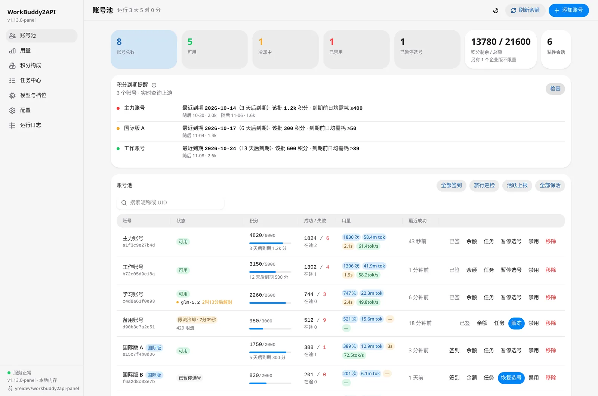
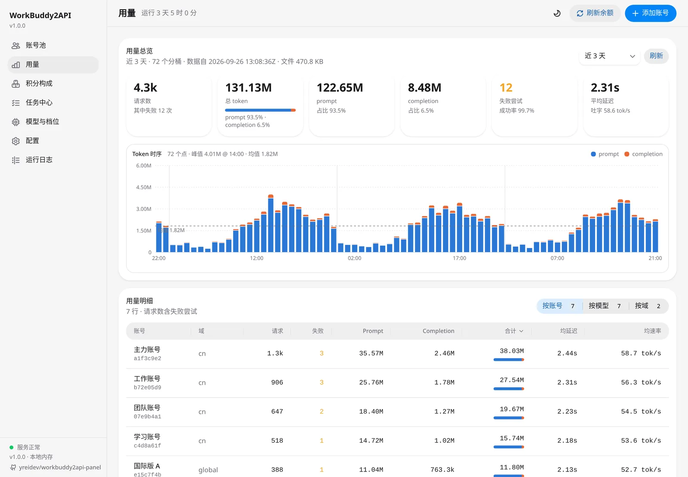
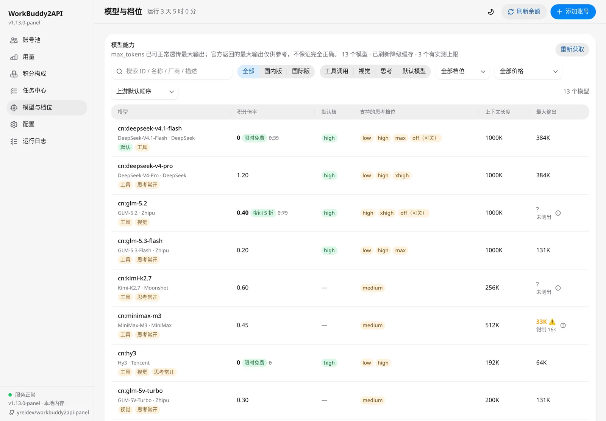
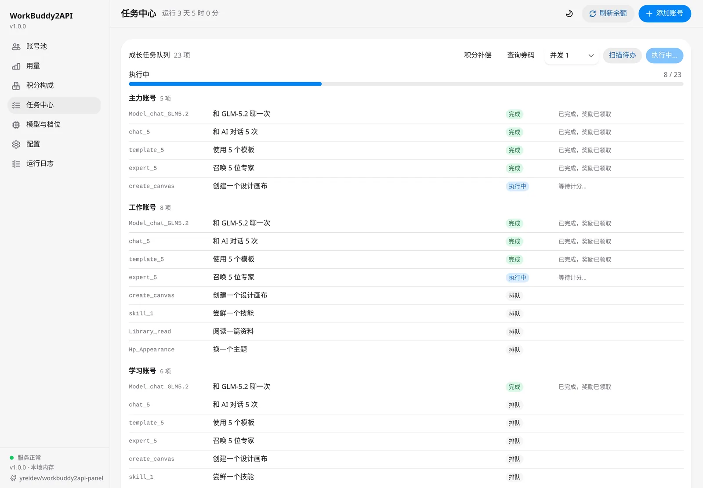
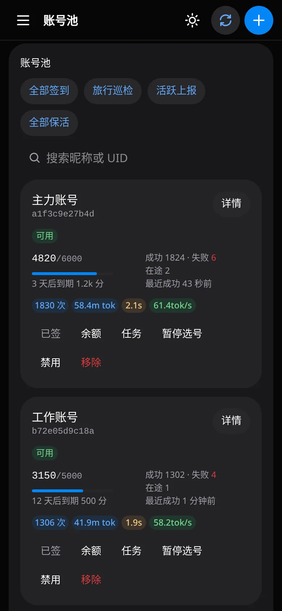
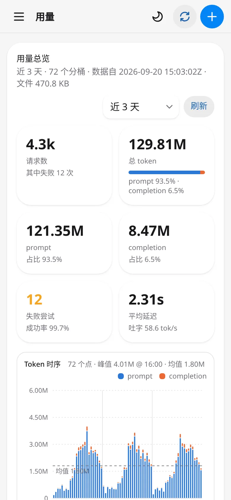
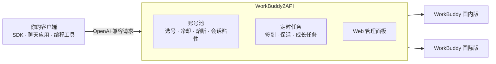

<div align="center">


# WorkBuddy2API Panel

**把腾讯 WorkBuddy 账号变成 OpenAI 兼容 API 的多账号网关**

账号池自动轮转 · 积分任务全自动 · 自带 Web 管理面板 · Docker / 单文件一键部署

[](https://github.com/yreidev/workbuddy2api-panel/actions/workflows/go-binaries.yml)
[](https://github.com/yreidev/workbuddy2api-panel/pkgs/container/workbuddy2api-panel)
[](https://github.com/yreidev/workbuddy2api-panel/releases/tag/latest)
[](go.mod)
[](docs/api.md)
[](LICENSE)

[快速开始](#快速开始) · [功能亮点](#功能亮点) · [接入客户端](#接入客户端) · [文档](#文档) · [致谢](#致谢)

</div>

<picture>
  <source media="(prefers-color-scheme: dark)" srcset="docs/images/hero-dark.webp">
  
</picture>

> [!IMPORTANT]
> 本项目只用于管理**你自己的**账号。严禁批量注册小号、转售额度、加壳或捆绑卡密收费，详见文末[使用声明](#使用声明)。

WorkBuddy2API 是一个自托管网关：把你的多个 WorkBuddy 账号接成一个 OpenAI 兼容的 API，自动挑选可用账号、处理限流与换号，并每天替你完成签到和成长任务。现有的 SDK、聊天应用、编程工具填上地址和密钥就能用。

本仓库基于 [linguo2625469/workbuddy2api-panel](https://github.com/linguo2625469/workbuddy2api-panel) 独立维护，管理面板用 React + HeroUI 重写。

## 功能亮点

- 🔌 **OpenAI 兼容，零改造接入**
  - 提供 `/v1/chat/completions` 与 `/v1/models`。
  - 流式、非流式、工具调用、图片输入、推理档位都支持。
- 🔄 **多账号池，坏了自动换**
  - 按实测成本、剩余积分、闲置时长加权选号。
  - 限流、余额不足、登录失效分别处置，出错自动换号重试。
  - 同一会话尽量不跳号。
- 🌏 **国内版 + 国际版同池管理**
  - 模型名加 `cn:` / `global:` 前缀指定走哪一版。
  - 也可打开跨域负载均衡，让两边的账号一起分担。
- 🎯 **积分任务全自动**
  - 每天自动签到、活跃上报、token 保活、连登兑换与抽奖。
  - 官方 18 个成长任务里 **17 个一键完成**，新账号约 **+1950 积分**。
- 🖥️ **好用的管理面板**
  - 账号状态与冷却倒计时、模型限额、用量与积分分析、任务中心、请求日志。
  - 在线改配置，大多立即生效；支持明暗主题和手机端。
- 📦 **部署省心**
  - 一条 `docker run`，或下载一个可执行文件直接运行。
  - 首次启动自动生成配置和随机密钥，在面板里用浏览器登录添加账号。

<table>
  <tr>
    <td width="50%" align="center"><b>用量分析</b><br></td>
    <td width="50%" align="center"><b>模型与档位</b><br></td>
  </tr>
  <tr>
    <td width="50%" align="center"><b>任务中心</b><br></td>
    <td width="50%" align="center"><b>手机端</b><br> </td>
  </tr>
</table>

<sub>截图均为演示数据。</sub>

## 快速开始

**1. 启动**（Docker，Linux x64）

```bash
mkdir -p workbuddy2api/auths workbuddy2api/data && cd workbuddy2api

docker run -d --name workbuddy2api --restart unless-stopped \
  --user "$(id -u):$(id -g)" -p 7863:7863 -e TZ=Asia/Shanghai \
  -v "$PWD/auths:/app/auths" -v "$PWD/data:/app/data" \
  ghcr.io/yreidev/workbuddy2api-panel:latest
```

首次启动会生成 `data/config.json`，`api_key` 是随机值，用 `grep api_key data/config.json` 查看。

**2. 添加账号**：浏览器打开 `http://localhost:7863/panel/`，输入密钥，点右上角「添加账号」，登录你的 WorkBuddy 账号（国内版、国际版都行）。账号立即进池，不用重启。

**3. 接入客户端**：Base URL 填 `http://localhost:7863/v1`，API Key 填上面的密钥，见下一节。

> [!TIP]
> 不用 Docker？到[最新构建](https://github.com/yreidev/workbuddy2api-panel/releases/tag/latest)下载对应平台的包（Windows / Linux / macOS），解压后直接运行 `wb2api`。Docker Compose、源码构建、升级与备份见[部署与运维](docs/deployment.md)。

## 接入客户端

任何支持 OpenAI 兼容接口的客户端都可以：Cherry Studio、Chatbox、Open WebUI、各类 SDK 与编程工具，填 Base URL 和 API Key 即可。

```bash
curl http://localhost:7863/v1/chat/completions \
  -H "Authorization: Bearer $API_KEY" \
  -H "Content-Type: application/json" \
  -d '{"model": "deepseek-v4-flash", "messages": [{"role": "user", "content": "你好"}], "stream": true}'
```

```python
from openai import OpenAI

client = OpenAI(base_url="http://localhost:7863/v1", api_key="sk-...")
resp = client.chat.completions.create(
    model="deepseek-v4-flash",
    messages=[{"role": "user", "content": "你好"}],
)
print(resp.choices[0].message.content)
```

可用模型以 `/v1/models` 或面板「模型与档位」为准。模型名不带前缀时默认走国内版，`global:gpt-5.5` 这样加前缀走国际版。

## 常用配置

配置文件是 JSON，面板「配置」页可以直接改。

| 字段 | 默认 | 说明 |
|---|---|---|
| `api_key` | 随机生成 | 网关与面板的密钥，**为空则不鉴权** |
| `pool.max_in_flight` | `3` | 单个账号同时处理的请求数 |
| `pool.cross_realm` | `false` | 不带前缀的模型名在国内版、国际版之间合池负载均衡 |
| `pool.credit_floor` | `0` | 余额低于该值的账号不再接收费模型，防止把余额打穿 |
| `prompt.mode` | `passthrough` | 客户端系统提示词常被上游审核误拦时，改成 `custom` |
| `schedule.*_enabled` | `true` | 签到、保活、成长任务等定时任务的开关 |

完整字段、默认值和环境变量见[配置](docs/configuration.md)。

## 工作原理



## 文档

| 文档 | 内容 |
|---|---|
| [部署与运维](docs/deployment.md) | Docker、Compose、二进制、源码构建；添加账号、升级、备份、优雅停机、工具脚本 |
| [配置](docs/configuration.md) | 全部配置项与默认值、上游超时、环境变量、热生效规则 |
| [网关与选号](docs/gateway.md) | 选号策略、跨域负载均衡、会话粘性、错误处置、提示词与内容审核、工具调用还原 |
| [定时任务与积分任务](docs/tasks.md) | 签到、成长任务一键完成、任务中心、连登、旅行、暂停选号、企业版账号 |
| [Web 管理面板](docs/panel.md) | 各视图功能、时间范围、调用来源、面板接口、安全响应头 |
| [API 参考](docs/api.md) | 对外端点、模型名、健康检查、请求日志、上游接口 |
| [安全与合规](docs/security.md) | 凭证保管、网络暴露、日志敏感度、使用边界 |
| [常见问题](docs/faq.md) | 权限报错、6004 限额、内容审核误拦、账号恢复等 |
| [项目来源与上游同步](docs/upstream.md) | 项目沿革、相对原始项目新增的能力、同步记录 |

## 致谢

本项目站在这些项目和贡献者的肩膀上：

- **[linguo2625469/workbuddy2api-panel](https://github.com/linguo2625469/workbuddy2api-panel)**：本仓库的直接上游。Web 管理面板、积分任务体系、请求指标等大量能力都来自这里，本仓库持续同步它的后端更新。
- **[Sliverkiss](https://github.com/Sliverkiss)**：原始项目 workbuddy2api 的作者，奠定了网关、账号池调度、错误分类与提示词体系（原仓库已删除）。
- **上游的每一位贡献者**：

  <a href="https://github.com/linguo2625469/workbuddy2api-panel/graphs/contributors"></a>

- **开源依赖**：
  - 前端：[HeroUI](https://github.com/heroui-inc/heroui)、[React](https://github.com/facebook/react)、[TanStack Query 与 Router](https://github.com/TanStack)、[Recharts](https://github.com/recharts/recharts)、[Tailwind CSS](https://github.com/tailwindlabs/tailwindcss)、[Gravity UI Icons](https://github.com/gravity-ui/icons)、[Vite](https://github.com/vitejs/vite)。
  - 后端：[go-redis](https://github.com/redis/go-redis)。
- **图标**：来自 [DGZSbot/ai-icon](https://github.com/DGZSbot/ai-icon)。

## 使用声明

本项目（含原始项目 Sliverkiss/workbuddy2api 与上游 linguo2625469/workbuddy2api-panel，下同）的开发初衷只有一个：**方便个人管理自己的 WorkBuddy 账号**，包括自动签到、保活，给自己的本地工具提供一个 OpenAI 兼容入口。它是免费、开源、按「原样」提供的个人自用工具。

近期我们发现有人将本项目用于以下行为：

- **批量注册小号 / 收购账号，对外提供付费 API、共享池、代充等业务**；
- **二次加壳、捆绑卡密（授权码）售卖**，或以「公益服」「低价中转」等名义变相收费分发。

我们对上述行为**表达最强烈的反对**，并声明如下：

1. **一切商用 / 售卖行为与本项目及作者无关。** 本项目不授权、不支持、不参与任何面向公众的 API 售卖、账号池出租、卡密收费分发；行为人由此产生的一切后果（包括但不限于账号封禁、条款违约与法律风险）由其自行承担，与作者和贡献者无任何关系。
2. **批量注册与转售接口配额违反目标平台服务条款。** 腾讯系服务条款禁止批量注册账号及商业转售接口。原始项目仓库已删除、停止公开维护，我们无法断定具体原因，但此类滥用行为正在毁掉所有正常使用者的环境，请勿再消耗社区的善意。
3. **请勿购买任何「收费版」「卡密版」「公益中转版」。** 本项目永远免费开源。任何加壳、加密、捆绑收费的「版本」都是他人篡改的产物，与本项目无关；且此类分发无法审计，存在被植入后门、回传并窃取你账号凭证的风险（`auths/` 中保存的是明文 access token / refresh token）。**你付钱买到的不是本项目，而是把自己账号交给陌生人的机会。**
4. **关于开源协议的诚实说明。** 本项目基于 MIT 协议开源，协议允许自由使用与修改源码，这是开源的本意，我们不会收回；但 MIT 赋予的是代码层面的自由，**不赋予**以本项目名义宣传、售卖、捆绑分发，或要求作者提供支持与背书的权利。作者不为任何第三方分发版本提供支持、更新承诺或安全保证。
5. **作者保留止损的权利。** 若滥用行为持续，作者可能随时停止维护、关闭或删除仓库，且不另行通知。

如果你的用途是管理自己的账号，欢迎正常使用、反馈问题与提交 PR。

## 免责声明

本项目是 WorkBuddy 的**非官方**网关，上游接口均为非公开接口，仅供学习和研究使用。使用者需遵守目标平台服务条款与所在地法律，自行承担使用风险（包括账号封禁、条款违约等）。作者不对任何因使用本项目产生的直接或间接损失负责。

## License

[MIT](LICENSE)。版权归原始项目作者 Sliverkiss、上游 linguo2625469 与本仓库作者共同所有；再分发时请保留 [LICENSE](LICENSE) 中的全部版权声明与许可声明。本项目不授予任何上游（WorkBuddy / 腾讯）接口或服务的权利。
