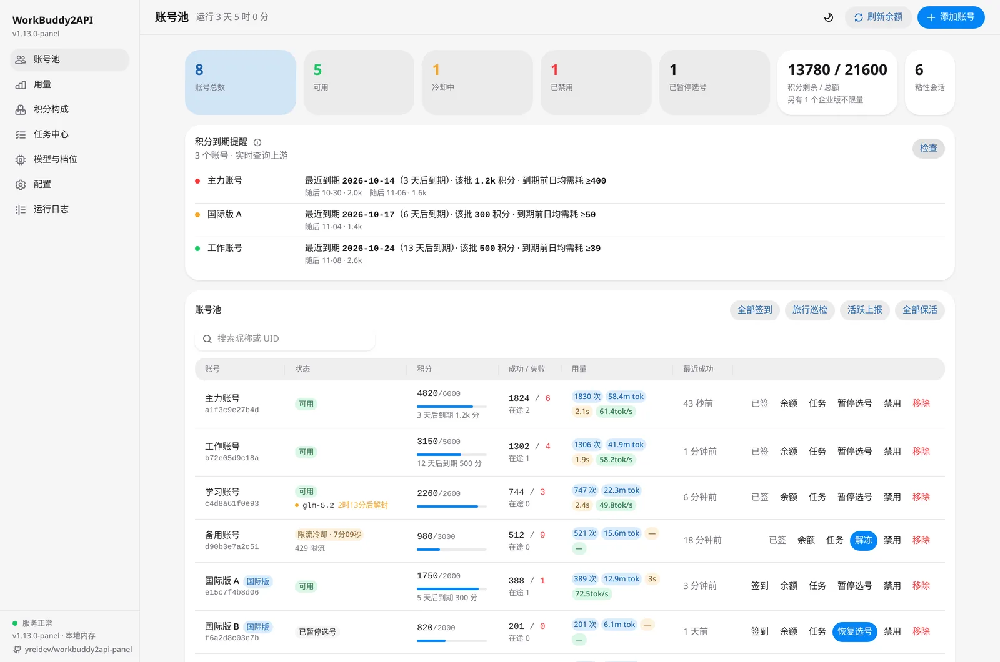
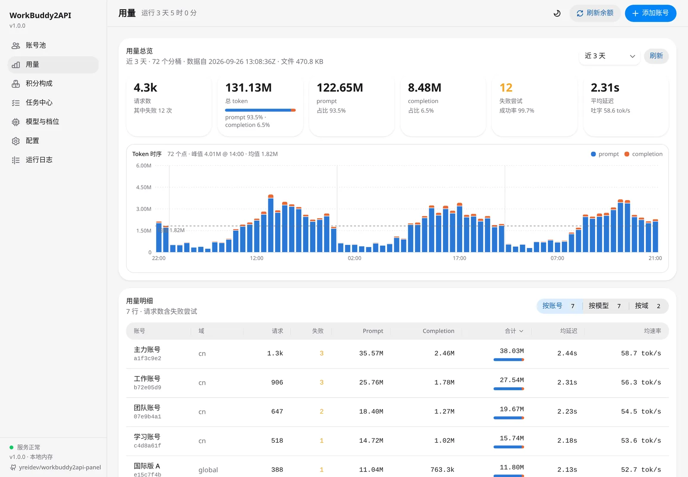
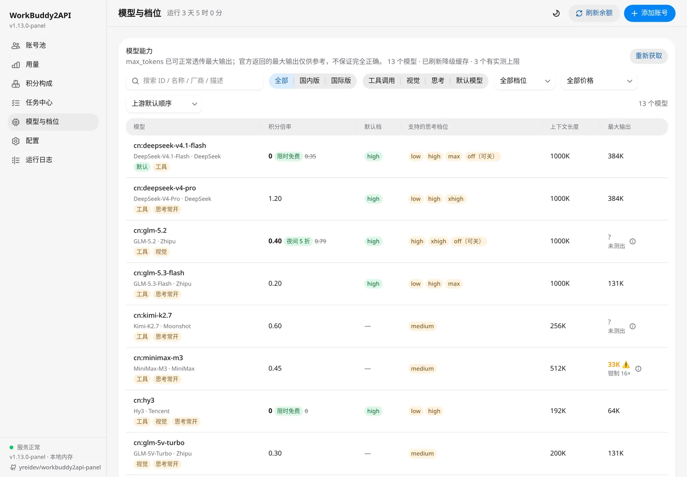
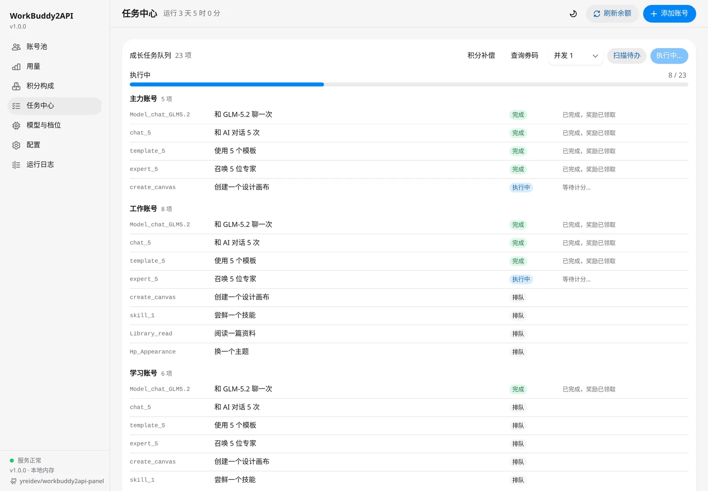
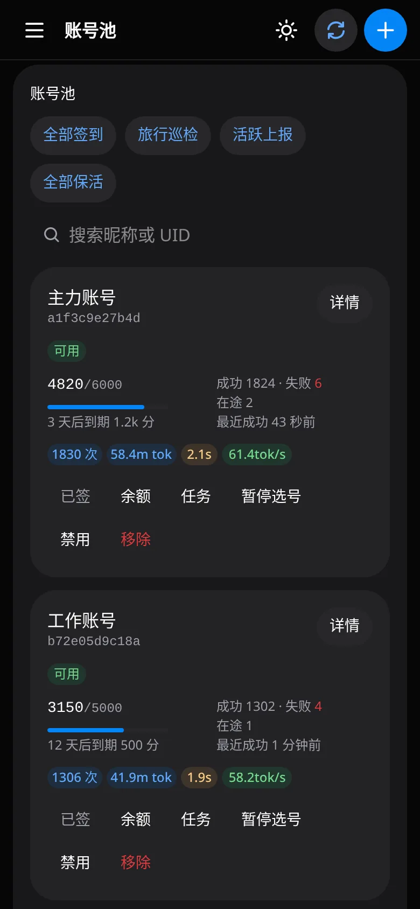
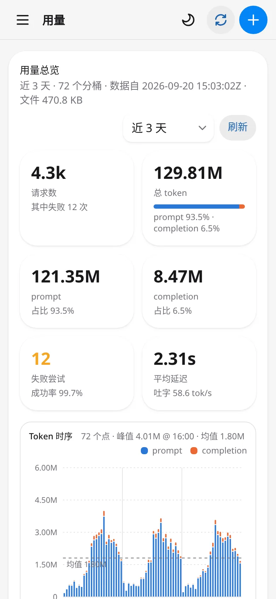
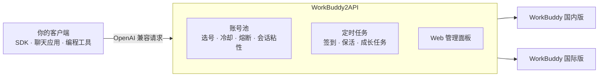

<div align="center">


# WorkBuddy2API Panel

**把腾讯 WorkBuddy 账号变成 OpenAI 兼容 API，Claude Code、Codex 直接接入，出站请求照官方客户端逐项对齐**

Claude Code / Codex 直连 · 模型路由 · 请求头对齐官方桌面端 5.9.3 · 主备入口与 HTTPDNS 自动切换 · 国内 / 国际双域合池 · 企业号用上 Claude · 积分任务全自动 · 面板一键更新

[](https://github.com/yreidev/workbuddy2api-panel/actions/workflows/go-binaries.yml)
[](https://github.com/yreidev/workbuddy2api-panel/releases/latest)
[](docs/deployment.md#从源码构建)
[](https://github.com/yreidev/workbuddy2api-panel/pkgs/container/workbuddy2api-panel)
[](https://github.com/yreidev/workbuddy2api-panel/releases/tag/latest)
[](go.mod)
[](docs/api.md)
[](LICENSE)

[快速开始](#快速开始) · [和原版比](#和原版比多了什么) · [功能亮点](#功能亮点) · [接入客户端](#接入客户端) · [Claude Code](#claude-code) · [Codex](#codex) · [文档](#文档) · [致谢](#致谢) · [许可与署名](#许可与署名)

</div>

<picture>
  <source media="(prefers-color-scheme: dark)" srcset="docs/images/hero-dark.webp">
  
</picture>

> [!IMPORTANT]
> 本项目只用于管理**你自己的**账号。严禁批量注册小号、转售额度、加壳或捆绑卡密收费，详见文末[使用声明](#使用声明)。

WorkBuddy2API 是一个自托管网关：把你的多个 WorkBuddy 账号接成一个 OpenAI 兼容的 API，自动挑选可用账号、处理限流与换号，并每天替你完成签到和成长任务。现有的 SDK、聊天应用、编程工具填上地址和密钥就能用。

## 和原版比多了什么

GitHub 上叫 workbuddy2api-panel 的仓库有好几个。本仓库是在原版 [linguo2625469/workbuddy2api-panel](https://github.com/linguo2625469/workbuddy2api-panel) 基础上**独立维护、独立发版**的增强版。原版已于 2026-10-21 停止维护，本仓库继续更新；同步到原版的哪一次提交见[同步记录](docs/upstream.md#同步记录)。和原版相比多了这些：

| | 本仓库 | 原版 |
|---|---|---|
| **Claude Code / Codex** | 原生提供 Anthropic Messages（`/v1/messages`）和 Responses（`/v1/responses`），填地址和密钥就能用；模型路由把它们的默认模型名改到上游模型，客户端不用配模型；Claude Code 自带的 WebSearch 直接能用，Codex 接网关的 MCP 服务器也能联网搜索 | 对话只有 `/v1/chat/completions`；联网搜索只有给 DSH 这类客户端调的 `/v1/search/messages` |
| **出站请求** | 照官方桌面端安装包（国内版 5.9.3、国际版 5.9.4）逐项对齐 UA、请求头、会话 id、链路头和 TLS 握手指纹，每一项的依据和还没对齐的地方都写在[官方客户端对照](docs/official-client.md) | UA 停在 WorkBuddy 5.5.4，还带着官方已经不发的 Origin、Referer 等旧请求头 |
| **网络容错** | 主入口出错切备用入口，DNS 失败或网关错误换 HTTPDNS 候选 IP，按入口熔断，规则照官方 | 单一入口，没有失败切换 |
| **对话隐私** | 默认告诉上游不许拿你的对话做模型优化（`X-Private-Data`），面板里可改 | 不发 |
| **企业号** | 用官方企业目录接口按账号拉模型，企业开通的 Claude 等模型只派给有它的号 | 所有企业号探测同一个旧端点 |
| **按号代理** | 每个号走自己的代理，分散出口 IP：代理分池、批量导入、按绑号最少分配并设上限；自动测连通、查出口 IP、到期提醒，代理坏了只暂停绑在上面的号、久了改绑；风控波按出口分开算 | 所有号从同一个出口 IP 出去 |
| **国内 + 国际** | 可以合成一个池负载均衡，或者国内版优先、国内版没号可用才用国际版（`pool.cross_realm`），也能用前缀钉死一域 | 用前缀分开用；另有默认关闭的跨域回退，国内选不到号才改用国际 |
| **会话缓存** | 客户端不带会话 id 时，从第一轮起给同一段对话定一个会话 id（UUID v7，官方形状），存盘、重启不变，两个域都发；换号时先回到这段对话用过的号 | 不带就拿网关自算的会话键充当，不是官方形状；连会话键也没有时每次随机补一个 |
| **成长中心** | 照官方桌面端用登录码换官网 Cookie 走网页接口，任务事件字段照 5.8.3 逐个核对 | 没有网页登录态 |
| **客户端密钥** | 给别人用另建密钥：到期时间、每天和总量上限、模型白名单、只用哪些分组的号，用量和请求记录按密钥分开 | 只有一把共用的 `api_key` |
| **管理面板** | React + HeroUI 重写，手机端、明暗主题、凭证导出与批量导出、多选批量操作 | 原生 JS 面板 |
| **升级** | 面板提醒新版本，一键更新，新版跑不稳自动退回 | 没有一键更新 |
| **工程质量** | 233 个测试文件，断网全量可跑，覆盖率 98.8%；CI 跑 gofmt、go vet、golangci-lint 和提交规则检查，提交全部签名 | 97 个测试文件 |

## 功能亮点

- 🛡️ **请求照官方客户端对齐**
  - 出站请求照官方桌面端安装包逐项对齐，对齐的依据和还没对齐的地方都写在[官方客户端对照](docs/official-client.md)，官方升级后照着核对。
  - 主入口出错时自动切备用入口，DNS 失败或网关错误换 HTTPDNS 候选 IP，切换规则照官方。
  - 默认不允许上游拿你的对话做模型优化。

- 🔌 **OpenAI、Claude Code、Codex 都能直接接**
  - 提供 `/v1/chat/completions` 与 `/v1/models`，流式、非流式、工具调用、图片输入、推理档位都支持。
  - Claude Code 走 `/v1/messages`，Codex 走 `/v1/responses`，和普通对话共用同一套选号、换号与日志。
  - 联网搜索走官方的搜索接口：Claude Code 自带的 WebSearch 不用配就能用，Codex 把网关的 `/mcp` 加成 MCP 服务器。
  - 模型路由：客户端发来上游没有的模型名（比如 Claude Code 的默认模型）时按规则改用上游模型，在面板里配。
- 🔄 **多账号池，坏了自动换**
  - 按实测成本、剩余积分、闲置时长加权选号。
  - 限流、余额不足、登录失效分别处置，出错自动换号重试。
  - 每个号都能一键测活；限流冷却、熔断中的号每 30 分钟自动测一次，测通就提前恢复。
  - 同一会话尽量不跳号。
  - 可限每个号同时几个请求、每分钟几个请求，满了换号或排队。
  - 号可以设优先级：主力号先用，都忙了才用备用号；上游说这个号不能用的模型自动屏蔽，也能手动给号排除模型。
- 🌐 **按号代理，分散出口 IP**
  - 号绑在代理池上，按绑号最少分到一个代理并固定下来；代理批量粘贴导入，先预览再导。
  - 自动测连通、查出口 IP，标出出口重复、和服务器同 IP、动态 IP；代理可设到期时间，提前提醒。
  - 代理坏了或到期，只暂停绑在上面的号、不罚号，久了自动改绑到同池能用的代理；从不退回服务器 IP。
- 🌏 **国内版 + 国际版同池管理**
  - 模型名加 `cn:` / `global:` 前缀指定走哪一版。
  - 也可打开跨域负载均衡，让两边的账号一起分担，或者国内版优先、国际版只做后备。
  - 企业号按自己的模型目录接请求，企业开通的模型（比如 Claude）也能用。
- 🎯 **积分任务全自动**
  - 每天自动签到、活跃上报、token 保活、连登兑换与抽奖。
  - 官方 18 个成长任务里 **17 个一键完成**，新账号约 **+1950 积分**。
  - 签到、领奖、补偿、旅行领到的积分逐笔记账，面板「积分获取」页按时间、账号、来源查。
- 🖥️ **好用的管理面板**
  - 账号状态与冷却倒计时、模型限额、用量与积分分析、任务中心、请求日志。
  - 给别人用另建客户端密钥，能限到期、用量和模型，还能只给它用某几个分组的号，用量按密钥统计。
  - 在线改配置，大多立即生效；支持明暗主题和手机端。
- 📦 **部署省心**
  - 一条 `docker run`，或下载一个可执行文件直接运行。
  - 首次启动自动生成配置和随机密钥，在面板里用浏览器登录添加账号。
  - 有新版本时面板提醒，一键更新，新版跑不稳自动退回。

<table>
  <tr>
    <td width="50%" align="center"><b>用量分析</b><br></td>
    <td width="50%" align="center"><b>模型与档位</b><br></td>
  </tr>
  <tr>
    <td width="50%" align="center"><b>任务中心</b><br></td>
    <td width="50%" align="center"><b>手机端</b><br> </td>
  </tr>
</table>

<sub>截图均为演示数据。</sub>

## 快速开始

**1. 启动**（Docker，Linux x64）

```bash
mkdir -p workbuddy2api/auths workbuddy2api/data && cd workbuddy2api

docker run -d --name workbuddy2api --restart unless-stopped \
  --user "$(id -u):$(id -g)" -p 7863:7863 -e TZ=Asia/Shanghai \
  -v "$PWD/auths:/app/auths" -v "$PWD/data:/app/data" \
  ghcr.io/yreidev/workbuddy2api-panel:latest
```

首次启动会生成 `data/config.json`，`api_key` 是随机值，用 `grep api_key data/config.json` 查看。

**2. 添加账号**：浏览器打开 `http://localhost:7863/panel/`，输入密钥，点右上角「添加账号」，登录你的 WorkBuddy 账号（国内版、国际版都行）。账号立即进池，不用重启。

**3. 接入客户端**：Base URL 填 `http://localhost:7863/v1`，API Key 填上面的密钥，见下一节。

> [!TIP]
> 不用 Docker？到[最新构建](https://github.com/yreidev/workbuddy2api-panel/releases/tag/latest)下载对应平台的包（Windows / Linux / macOS），解压后直接运行 `wb2api`。Docker Compose、源码构建、升级与备份见[部署与运维](docs/deployment.md)。

## 接入客户端

任何支持 OpenAI 兼容接口的客户端都可以：Cherry Studio、Chatbox、Open WebUI、各类 SDK 与编程工具，填 Base URL 和 API Key 即可。Claude Code、Codex 的接法见下面两小节。

```bash
curl http://localhost:7863/v1/chat/completions \
  -H "Authorization: Bearer $API_KEY" \
  -H "Content-Type: application/json" \
  -d '{"model": "deepseek-v4-flash", "messages": [{"role": "user", "content": "你好"}], "stream": true}'
```

```python
from openai import OpenAI

client = OpenAI(base_url="http://localhost:7863/v1", api_key="sk-...")
resp = client.chat.completions.create(
    model="deepseek-v4-flash",
    messages=[{"role": "user", "content": "你好"}],
)
print(resp.choices[0].message.content)
```

可用模型以 `/v1/models` 或面板「模型与档位」为准。模型名不带前缀时默认走国内版，`global:gpt-5.5` 这样加前缀走国际版。

### Claude Code

```bash
export ANTHROPIC_BASE_URL=http://localhost:7863   # 不带 /v1
export ANTHROPIC_AUTH_TOKEN=sk-...                # 网关的 api_key
claude
```

也可以写进 `~/.claude/settings.json` 的 `env` 里长期生效。模型有两种配法，任选其一：

- **在面板配模型路由（推荐）**：「模型与档位 → 模型路由」点「添加 Claude Code 三档」，给 opus、sonnet、haiku 各选一个上游模型。客户端什么都不用改，`/model` 切档位就是切规则；
- **在客户端指定**：`export ANTHROPIC_MODEL=glm-5.2`，或分别设 `ANTHROPIC_DEFAULT_OPUS_MODEL`、`ANTHROPIC_DEFAULT_SONNET_MODEL`、`ANTHROPIC_DEFAULT_HAIKU_MODEL`。

Claude Code 自带的 WebSearch 工具不用配：网关认出它发来的搜索请求，不交给模型，直接用官方的联网搜索接口搜，见 [API 参考](docs/api.md#联网搜索)。

上游模型的上下文比 Claude 小时，把 `CLAUDE_CODE_AUTO_COMPACT_WINDOW` 设成该模型的上下文长度（Claude Code 最低只认 100000），让它提前压缩对话。Anthropic 不为「Claude Code 接非 Claude 模型」提供支持，遇到问题请在本仓库反馈。

### Codex

在 `~/.codex/config.toml` 里加一个提供方：

```toml
model_provider = "wb2api"
# model = "glm-5.2"   # 配了模型路由可以不写，用 Codex 默认的模型名再由网关改写

[model_providers.wb2api]
name = "WorkBuddy2API"
base_url = "http://localhost:7863/v1"
env_key = "WB2API_KEY"   # 从这个环境变量读网关的 api_key
wire_api = "responses"
```

然后 `export WB2API_KEY=sk-...` 再运行 `codex`。`model_provider` 只能写在用户目录的配置里，项目里的 `.codex/config.toml` 会忽略它。

Codex 自带的网页搜索接不了上游（翻译时丢掉）。要联网搜索，在同一个文件里把网关的 `/mcp` 加成 MCP 服务器，模型就多一个 `mcp__wb2api__web_search` 工具：

```toml
[mcp_servers.wb2api]
url = "http://localhost:7863/mcp"
bearer_token_env_var = "WB2API_KEY"   # 和上面的 env_key 用同一个变量
```

`codex mcp list` 能看到它就是配好了。

两个入口的翻译细节、模型路由的匹配规则见 [API 参考](docs/api.md#claude-code-与-codex-入口)。

### 给别人用

在面板「密钥」页建客户端密钥发给对方，不要把 `api_key` 发出去。客户端密钥只能调 `/v1/*` 和 `/mcp`、登不了面板，可以单独设到期时间、每天和总量的请求次数 / token / 积分上限、能用哪些模型、只用哪些账号分组的号，用量和请求记录按密钥分开统计；「接入方法」里有密钥原文和各客户端的填法。建过客户端密钥以后 `/v1/*` 和 `/mcp` 必须带有效密钥，规则见 [API 参考](docs/api.md#客户端密钥)。

## 常用配置

配置文件是 JSON，面板「配置」页可以直接改。

| 字段 | 默认 | 说明 |
|---|---|---|
| `api_key` | 随机生成 | 管理员密钥（网关与面板），**为空则不鉴权**；给别人用另建[客户端密钥](#给别人用) |
| `pool.max_in_flight` | `3` | 单个账号同时处理的请求数 |
| `pool.cross_realm` | `off` | 不带前缀的模型名怎么在两个域之间分：`off` 只走国内版，`merge` 合池负载均衡，`cn_first` 国内版优先、没号可用才用国际版 |
| `pool.credit_floor` | `0` | 余额低于该值的账号不再接收费模型，防止把余额打穿 |
| `prompt.mode` | `passthrough` | 客户端系统提示词常被上游审核误拦时，改成 `custom` |
| `schedule.*_enabled` | `true` | 签到、保活、成长任务等定时任务的开关 |

完整字段、默认值和环境变量见[配置](docs/configuration.md)。

## 工作原理



## 文档

| 文档 | 内容 |
|---|---|
| [部署与运维](docs/deployment.md) | Docker、Compose、二进制、源码构建；添加账号、升级、备份、优雅停机、工具脚本 |
| [配置](docs/configuration.md) | 全部配置项与默认值、上游超时、环境变量、热生效规则 |
| [网关与选号](docs/gateway.md) | 选号策略、跨域负载均衡、会话粘性、错误处置、提示词与内容审核、工具调用还原 |
| [按号代理与代理池](docs/proxy.md) | 代理池分组、批量导入、分配与上限、代理不通与到期、出口 IP、只许走号的代理、风控波按出口分开算 |
| [定时任务与积分任务](docs/tasks.md) | 签到、成长任务一键完成、任务中心、连登、旅行、暂停选号、企业版账号 |
| [Web 管理面板](docs/panel.md) | 各视图功能、时间范围、调用来源、更新提醒与一键更新、面板接口、安全响应头 |
| [API 参考](docs/api.md) | 对外端点、Claude Code 与 Codex 入口、模型名与模型路由、健康检查、请求日志、上游接口 |
| [官方客户端对照](docs/official-client.md) | 出站请求按官方桌面端对齐的依据、未对齐项、官方升级后怎么核对 |
| [安全与合规](docs/security.md) | 凭证保管、网络暴露、日志敏感度、使用边界 |
| [常见问题](docs/faq.md) | 权限报错、6004 限额、内容审核误拦、账号恢复等 |
| [项目来源与上游同步](docs/upstream.md) | 项目沿革、相对原始项目新增的能力、同步记录 |
| [更新日志](docs/CHANGELOG.md) | 每个版本的新增、变更与修复 |
| [发版与版本号](docs/releasing.md) | 版本号规则、发版流程、更新日志的格式 |
| [提交规则](docs/commits.md) | 提交信息格式、type 与 scope、CI 检查与本地钩子 |
| [AGENTS.md](AGENTS.md) | 给 AI 编程工具看的开发说明，以及复制、借鉴本项目代码时的署名要求 |

## 致谢

本项目站在这些项目和贡献者的肩膀上：

- **[linguo2625469/workbuddy2api-panel](https://github.com/linguo2625469/workbuddy2api-panel)**：本仓库的直接上游，已于 2026-10-21 停止维护。Web 管理面板、积分任务体系、请求指标等大量能力都来自这里。
- **[Sliverkiss](https://github.com/Sliverkiss)**：原始项目 workbuddy2api 的作者，奠定了网关、账号池调度、错误分类与提示词体系（原仓库已删除）。
- **同类项目**：
  - [corrinehu](https://github.com/corrinehu) 的 dsh-workbuddy-connect：企业号拉模型目录必须带齐企业身份的实测（issue #123），企业版模型的支持据此实现（原仓库已删除）。
  - [caigee-cmd/cli2api](https://github.com/caigee-cmd/cli2api)：每个账号各拉一份模型目录、按目录选号的做法，企业号的对话请求头，以及号没设代理时回落全局代理的做法。
  - [ardeyouxipianyi/workbuddy2api-hub](https://github.com/ardeyouxipianyi/workbuddy2api-hub)：自我介绍句、DeepSeek Harness、OhMyOpenCode 这几类渠道指纹的清洗规则，国际版号成批被 11140 风控时整域暂停的做法（issue #629），以及每段对话记下用过的号、换号时先回到这些号的做法。
  - [ithtelab/workbuddy-manager](https://github.com/ithtelab/workbuddy-manager)、[mmqz/cpa-multi-plugins](https://github.com/mmqz/cpa-multi-plugins)：渠道指纹在助手历史和用户消息里同样会被拦的实测；cpa-multi-plugins 凭证文件里带 `proxy_url` 的写法，导入凭证时据此认出号的代理。
  - [sofs2005/w2a](https://github.com/sofs2005/w2a)：用原始字节确认上游回的是数字码 `11128`。
  - [misakano7545/workbuddy2api-panel](https://github.com/misakano7545/workbuddy2api-panel)：AutoBot.yml 整理好的同类项目清单；对齐登录的提交提醒了授权被拒的登录业务码和毫秒的到期时间，网关对照官方安装包核实后补上；它的真机抓包里积分、签到用的是 `axios/1.16.1`，国际版后台请求的 UA 两段都是 `workbuddy-ai`，网关据此回安装包查实，改掉了这两处旧缺口。
  - [magpie-community/plugins](https://github.com/magpie-community/plugins) 的 WorkBuddy 插件：对齐桌面端 5.9.3 时对照了它的请求头，它的说明提醒了官方对话经 OpenAI SDK 发出、带 `X-Stainless-*` 头，网关对照官方安装包核实后记进了[官方客户端对照](docs/official-client.md#与桌面端-593-的对照)。
- **其他 API 网关**：
  - [QuantumNous/new-api](https://github.com/QuantumNous/new-api)：调用日志单独成页、失败请求直接显示原因的做法，以及渠道测试（单测、测试全部、定时只测被自动禁用的渠道、测通自动启用）的做法，网关的账号测活照此实现。
  - [router-for-me/Cli-Proxy-API-Management-Center](https://github.com/router-for-me/Cli-Proxy-API-Management-Center)：账号卡片网格的排法，以及日志页把服务日志和出错请求分开的做法。
  - [Wei-Shaw/sub2api](https://github.com/Wei-Shaw/sub2api)：号都在途占满时请求排队等空位、最多等 30 秒的做法（`fallback_wait_timeout`），每号每分钟请求数上限（账号的 `base_rpm`），以及各类日志各设保留天数、改了立即生效的做法（`ops.cleanup` 的 `*_retention_days`），账号「测试连接」弹窗和定时测试测通后自动恢复账号（`auto_recover`）的做法，以及代理管理的做法（代理表、账号绑定代理、代理到期、经代理查出口 IP、错误按代理归因），代理池照此实现；账号分组、API 密钥绑分组和账号优先级（`priority`，数字小的先用、只在最高一层里挑）也照它的做法。
- **上游的每一位贡献者**：

  <a href="https://github.com/linguo2625469/workbuddy2api-panel/graphs/contributors"></a>

- **开源依赖**：
  - 前端：[HeroUI](https://github.com/heroui-inc/heroui)、[React](https://github.com/facebook/react)、[TanStack Query 与 Router](https://github.com/TanStack)、[Recharts](https://github.com/recharts/recharts)、[Tailwind CSS](https://github.com/tailwindlabs/tailwindcss)、[Gravity UI Icons](https://github.com/gravity-ui/icons)、[Vite](https://github.com/vitejs/vite)。
  - 后端：[CLIProxyAPI](https://github.com/router-for-me/CLIProxyAPI)（Claude Code、Codex 入口的协议翻译层）、[go-redis](https://github.com/redis/go-redis)、[andybalholm/brotli](https://github.com/andybalholm/brotli)、[klauspost/compress](https://github.com/klauspost/compress)。
- **图标**：来自 [DGZSbot/ai-icon](https://github.com/DGZSbot/ai-icon)。

## 使用声明

本项目（含原始项目 Sliverkiss/workbuddy2api 与上游 linguo2625469/workbuddy2api-panel，下同）的开发初衷只有一个：**方便个人管理自己的 WorkBuddy 账号**，包括自动签到、保活，给自己的本地工具提供一个 OpenAI 兼容入口。它是免费、开源、按「原样」提供的个人自用工具。

近期我们发现有人将本项目用于以下行为：

- **批量注册小号 / 收购账号，对外提供付费 API、共享池、代充等业务**；
- **二次加壳、捆绑卡密（授权码）售卖**，或以「公益服」「低价中转」等名义变相收费分发。

我们对上述行为**表达最强烈的反对**，并声明如下：

1. **一切商用 / 售卖行为与本项目及作者无关。** 本项目不授权、不支持、不参与任何面向公众的 API 售卖、账号池出租、卡密收费分发；行为人由此产生的一切后果（包括但不限于账号封禁、条款违约与法律风险）由其自行承担，与作者和贡献者无任何关系。
2. **批量注册与转售接口配额违反目标平台服务条款。** 腾讯系服务条款禁止批量注册账号及商业转售接口。原始项目仓库已删除、停止公开维护，我们无法断定具体原因；上游 linguo2625469/workbuddy2api-panel 也已于 2026-10-21 停止维护，公开列出的原因之一就是非法转卖泛滥。此类滥用行为正在毁掉所有正常使用者的环境，请勿再消耗社区的善意。
3. **请勿购买任何「收费版」「卡密版」「公益中转版」。** 本项目永远免费开源。任何加壳、加密、捆绑收费的「版本」都是他人篡改的产物，与本项目无关；且此类分发无法审计，存在被植入后门、回传并窃取你账号凭证的风险（`auths/` 中保存的是明文 access token / refresh token）。**你付钱买到的不是本项目，而是把自己账号交给陌生人的机会。**
4. **关于开源协议的诚实说明。** 本项目自 v1.4.0 起改用 AGPL-3.0 并附署名条款（见[许可与署名](#许可与署名)），v1.3.0 及更早的版本仍是 MIT。使用、修改、分发的自由不变，这是开源的本意，我们不会收回；但分发或对外提供服务的人必须公开源码、保留署名，加壳闭源售卖不在许可之内。许可赋予的是代码层面的自由，**不赋予**以本项目名义宣传、售卖、捆绑分发，或要求作者提供支持与背书的权利。作者不为任何第三方分发版本提供支持、更新承诺或安全保证。
5. **作者保留止损的权利。** 若滥用行为持续，作者可能随时停止维护、关闭或删除仓库，且不另行通知。

如果你的用途是管理自己的账号，欢迎正常使用、反馈问题与提交 PR。

## 免责声明

本项目是 WorkBuddy 的**非官方**网关，上游接口均为非公开接口，仅供学习和研究使用。官方可能随时收紧对非官方客户端的识别和拦截，本项目可能因此部分或全部不可用。使用者需遵守目标平台服务条款与所在地法律，自行承担使用风险（包括账号封禁、条款违约等）。作者不对任何因使用本项目产生的直接或间接损失负责。

## 许可与署名

本项目自 v1.4.0 起以 [AGPL-3.0-only](LICENSE) 授权，并依 AGPL-3.0 第 7 条附加署名条款，条款全文见 [NOTICE](NOTICE)；v1.3.0 及更早的版本仍是 MIT。版权归原始项目作者 Sliverkiss、上游 linguo2625469、本仓库作者与各位贡献者共同所有，来自上游部分的 MIT 声明保留在 NOTICE 里。

可以使用、修改、分发，也可以商用。复制或改写了本项目的代码（整个文件、部分文件、代码片段，或翻译成别的语言）时：

- 保留 LICENSE、NOTICE 和各源文件开头的版权声明；
- 在 README 或主要说明文档的显眼处写明出处并附上链接，例如：

  ```text
  本项目基于 / 包含了 workbuddy2api-panel 的代码：https://github.com/yreidev/workbuddy2api-panel（AGPL-3.0）
  ```

- 有界面的（网页面板、桌面程序、命令行交互界面等），在「关于」窗口或页脚里写明同样的出处和链接；
- 修改版要标明改过，不得冒充原版、官方发布版或作者认可的版本；
- 分发，或者让别人通过网络使用修改版（例如对外提供 API），要以 AGPL-3.0 向这些用户提供完整源码。

只参考了实现思路、协议分析或文档（例如[官方客户端对齐记录](docs/official-client.md)），没有复制代码的，许可管不到，但也请在致谢里注明并附上链接。用 AI 编程工具处理本仓库时，工具会读到根目录的 [AGENTS.md](AGENTS.md)，里面写着同样的要求。

本项目不授予任何上游（WorkBuddy / 腾讯）接口或服务的权利。
