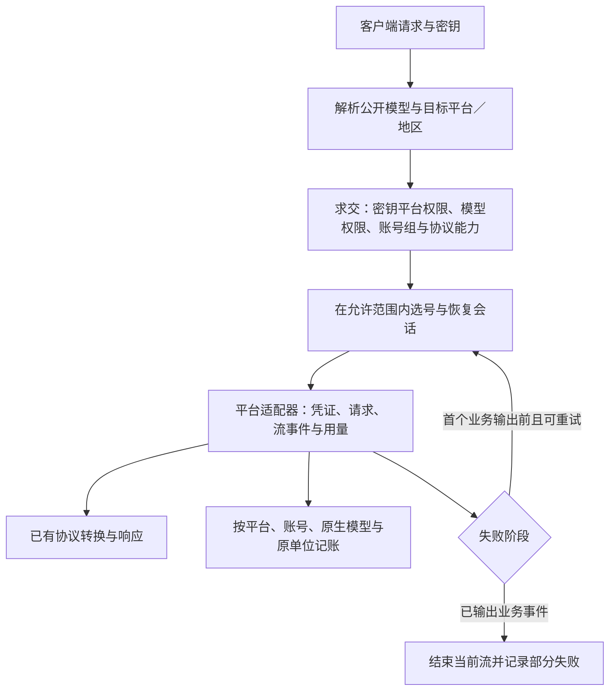

# 多平台接入与同类产品调研

调研日期：2026-11-16。需求入口：[issue #9](https://github.com/yreidev/workbuddy2api-panel/issues/9)。本报告记录公开资料与源码研究；后续首期实现已进入代码，覆盖 TraeWork 国内、Trae Code 国内、Qoder 国内／国际，详见[多平台上游（实验）](multi-platform.md)。尚未使用真实账号验证登录、推理或额度扣减。

核心结论：多平台接入不能只增加几个 Base URL。应把平台、地区、账号身份、模型身份和客户端密钥的授权范围贯穿请求全程；在这些边界内复用已有的选号、冷却、会话粘性与协议转换。调研建议先确认 TraeWork 国内版的真实 Work 通道与额度来源。后续经用户确定，首期同时实现 TraeWork／Trae Code 国内与 Qoder 国内／国际，分别保留产品和地区边界。

## 范围与证据

用户指定覆盖同类网关、平台转 API 项目和 AI 编程产品，重点研究多平台接入设计。本次覆盖：

- WorkBuddy 生态清单中的 90 个仓库，含本仓库作为对照；86 个可访问，85 个取得根目录 `README.md`，逐项记录见[调研清单](competitor-research-inventory.md)。这是清单全量初筛，不代表穷尽所有同类项目。
- 清单之外补充通用网关、Trae／Qoder 专项适配，以及 Kiro、Antigravity、Cursor、Windsurf 等项目。重点项目进一步阅读平台接口、路由、凭证刷新、流式处理或权限源码，固定版本见文末。
- 13 类官方产品／产品形态的认证、BYOK、额度与开放入口文档。TRAE 国内外与 Work 形态分别记录，不视为 4 家独立厂商。

下文的“文档”表示作者或官方的自述，“源码”表示在所列版本中存在相应实现，“作者验收”表示项目维护者报告的测试。这三者均不等于本轮真账号实测。未取得证据的能力明确留作未确认；不据项目名字、模型菜单或兼容协议推断额度归属。

## 先区分接入的四种东西

| 接入类型 | 典型对象 | 消耗什么 | 需要研究什么 |
|---|---|---|---|
| 标准推理 API | OpenAI／Anthropic 兼容服务、云模型服务 | API 账户或项目预算 | 模型映射、协议、API key、限流与费用 |
| 官方 SDK／CLI | Copilot SDK、Kiro CLI、Qoder CLI、Codex | 取决于认证模式，可能是订阅权益，也可能是独立 API 账单 | 官方入口、授权范围、会话、进程与用量来源 |
| 非公开平台接口适配 | TraeWork／Qoder／WorkBuddy 的第三方转 API 项目 | 项目声称对应的平台账号额度，须单独验收 | 产品通道、设备与会话、令牌刷新、SSE、实际扣费 |
| BYOK／组织管理接口 | 编辑器的自定义模型、组织成员／用量 API | BYOK 通常走外部 provider 账单；管理 API 本身不是推理 | 调用方向、权限与账本；不能作为订阅额度可导出的证据 |

“产品支持 OpenAI 模型”“能填 API Key”“有 OpenAPI”都不足以说明它提供可消费个人订阅额度的 OpenAI 兼容推理端点。反过来，也不能一概说订阅权益都没有官方自动化入口：Kiro CLI 和 Copilot SDK 已有明确的官方路径。

## 最接近本仓库的多平台项目

| 项目 | 已读证据与多平台方式 | 值得借鉴 | 边界与未确认项 |
|---|---|---|---|
| [cli2api](https://github.com/caigee-cmd/cli2api) | 源码：provider／region 注册；聊天与模型能力；可选探活、签到等接口；key 的 provider／region grants；Trae 与 Qoder 适配 | 平台身份与地区分开；先授权后选号；不要求所有平台实现所有任务 | README 明确部分平台真账号验收尚未完成；Qoder 同时有 Go direct／PAT Bridge 和保留的 worker 路径，不能概括成一律依赖 Node |
| [Magpie plugins](https://github.com/magpie-community/plugins) | 源码：WorkBuddy、Trae、Qoder 插件；Trae 国内／国际、设备与会话、流事件；Qoder PAT／刷新处理 | 按产品场景组织模型；稳定设备与会话；一次性 refresh token 的刷新锁和持久化 | 是宿主插件；Trae 文档同时有 experimental 提示和局部真号修复记录，不能统称全未测试或全部验收。Qoder 真号成功是作者报告 |
| [Trae2api-cn](https://github.com/autumnsentiment/Trae2api-cn) | 源码与 README：Remote、Solo、IDE Agent、Work 多通道；Work 的 `solo_work_remote` 适配 | 查明 Work 的真实请求链、SSE 与模式差异 | README 描述 Work／Remote 之间的回落；可能改变所用产品和额度，不能照搬为静默兜底 |
| [Qoder-2API-Go](https://github.com/EchoPing07/Qoder-2API-Go) | 源码与 README：PAT、国内／国际、多账号、路由、会话；额度字段和缺失 usage 的说明 | 官方周期、实际 credits 与原始 credits 分开；流中断缺 usage 时不捏造 token 或费用 | 本轮未独立验证额度扣减；路由后裸模型统计不能直接用于多平台同名模型聚合 |
| [Reso2api](https://github.com/Libra1337/Reso2api) | 源码：Go 与嵌入前端；WorkBuddy／TraeWork／Qoder；provider 接口与前缀路由 | 与本仓库交付形态接近，可参考最小接入面 | 接口仍包含签到与资源查询等共同假设；跨平台“总积分”不宜照搬。实际 LICENSE 为 MIT，不能只看 metadata 的 NOASSERTION |
| [Buddy2api](https://github.com/wicm84266964/Buddy2api) | README 与协议源码：多通道、统一入口、显式 `通道/模型` 与自动选择；协议中保留当前路由跳的信息 | 公开模型与内部模型分开；请求最终去了哪家可解释 | 旧多通道设计文档顶部已声明 2026-11-01 删除数据面通道绑定，不能当作当前 key 必绑通道的依据；自动跨平台策略也不直接适用于 #9 |
| [API-Console](https://github.com/zhangdailin/API-Console) | 源码：`/{provider}/v1` 路径隔离；平台枚举和 ChatOnly 等能力限制 | 路径也是平台命名空间；不支持的协议应明确拒绝 | 当前枚举为 WorkBuddy／Cline／Grok／Doubao／Warp，与仓库简介提及的 Qoder 不一致，以源码为准；未发现根许可证 |
| [dsh-wtq-pool](https://github.com/chengzhi-c/dsh-wtq-pool)／[pi-desktop-wtq-pool](https://github.com/chengzhi-c/pi-desktop-wtq-pool) | README：读取本机登录；WorkBuddy／Trae／Qoder；独立 provider、本地端点与账号池 | 登录复用、平台端点隔离；区分请求错误与账号故障 | 宿主内本地桥接，不等于独立服务器部署；本轮未做全适配器审计 |
| [TraeWorkAssistant](https://github.com/smart-open/TraeWorkAssistant)／[账号切换器](https://github.com/NextAgentX/qoder-trae-workbuddy-switch) | README：多平台账号、登录切换、设备隔离、额度看板与转 API | 面板把平台、地区、登录状态和余额来源展示清楚 | 桌面账号管理与网关数据面应分层；后者为 PolyForm Noncommercial 许可证，不能当作 MIT 项目 |
| [agent2api](https://github.com/aimod-cc/agent2api)／[AgentHub](https://github.com/HUIdada1/AgentHub) | README：多客户端账号、统一网关、路由或插件、额度与桌面管理 | 新平台不应污染公共调度；账号管理与推理能力分别描述 | 平台数量是作者宣称，不代表本轮逐家验收；不为首个新增平台引入完整插件市场或客户端接管体系 |
| [codearts2api](https://github.com/zhuweiyou/codearts2api) | README：独立宿主装载 `iJetLi/dsh-providers-hub` 插件 | 研究宿主与适配器边界，追到真正的协议实现 | 不是仓库自身独立实现十几家协议；未发现根许可证，插件也须分别核对 |
| [wb-proxy](https://github.com/cty1735/wb-proxy)／[modelmux](https://github.com/bluechonk/modelmux) | README：前者 WorkBuddy／Qoder／Trae 账号池与限额；后者按渠道额度汇入少数模型族 | 额度护栏、账号状态、自动路由的可解释性 | 聚合裸模型并自动换平台，会影响“固定消费某平台”的语义；必须显式选择策略 |
| [CreditDaddy](https://github.com/techysy/CreditDaddy) | README：多平台账号、签到、额度展示，接入 10Router | 把账号管理与网关用量关联 | 网关依赖外部组件，不能把面板支持平台数当作自有推理适配器数量 |

对第一轮实现，优先对照 cli2api 的平台／地区和 grants、Magpie 的设备／会话与刷新、Trae2api-cn 的 Work 通道、Reso2api 的 Go 接口。Qoder 阶段再对照 Qoder-2API-Go 的路由与账本处理。这是阅读优先级，不是建议复制整套代码。

## 通用网关：复用哪些成熟设计

| 项目 | 本轮阅读范围 | 多平台设计启示 | 本仓库的取舍 |
|---|---|---|---|
| [CLIProxyAPI](https://github.com/router-for-me/CLIProxyAPI) | auth 类型、executor、模型别名、selection／stream／refresh 与配置 | provider 执行器和协议 translator 分开；账号前缀、模型级状态、刷新和业务并发分别处理；区分首个业务输出前后的失败 | 本仓库已使用其 v8 translator，继续复用；不要为每个平台重写三套入站协议 |
| [sub2api](https://github.com/Wei-Shaw/sub2api) | 账号与分组 schema、gateway、token refresher | Account.Platform、Group.Platform、按组模型路由；刷新集中处理，避免散落到每条请求链 | 学边界和刷新流程；暂不引入其数据库／Redis／运营体系 |
| [new-api](https://github.com/QuantumNous/new-api) | channel、token、distributor、channel service | 渠道类型、模型映射、分组、优先级与权重各司其职；模型白名单与上游模型别名分开 | 不把平台身份藏在用户组名或字符串替换里；沿用现有账号池即可 |
| [claude-relay-service](https://github.com/Wei-Shaw/claude-relay-service) | Claude 与 OpenAI scheduler | 强制绑定不可用时明确报错；专号回落是显式选项；保留会话粘性 | “固定平台”必须约束每一次重试和回落，不能只约束第一次选号 |
| [9router](https://github.com/decolua/9router) | Trae／Qoder／Qoder-CN registry、executor、combo 实现与文档 | provider 注册与组合路由分层；跨平台 combo 是可配置策略 | 当前 Trae registry 指向 `core-normal.trae.ai/api/remote/v1` 的 SOLO remote，不能据此认定 TraeWork 国内 Work 通道已验证 |
| [Bifrost](https://github.com/maximhq/bifrost) | provider／account schema、virtual key、routing、budget 文档 | virtual key 同时限制 provider、model 和具体上游 key；预算与请求／token 限流分开 | 借鉴授权交集和管理面／数据面分离；不把平台积分统一换算成美元 |
| [Portkey Gateway](https://github.com/Portkey-AI/gateway) | 条件路由、retry handler、共享类型 | fallback、retry、条件路由是显式请求策略 | 与订阅凭证适配不是同一层；策略应在明确允许的平台集合内执行 |
| [LiteLLM](https://github.com/BerriAI/litellm) | README 与根／enterprise 许可证 | 大规模 provider 目录、模型别名与统一调用面值得对照 | 本轮未深入其调度源码；不把文档能力写成已核实的实现细节 |
| [one-api](https://github.com/songquanpeng/one-api)／[one-hub](https://github.com/MartialBE/one-hub)／[VoAPI](https://github.com/VoAPI/VoAPI) | README、许可证 | 渠道管理、模型映射与密钥分发的产品形态 | 偏运营聚合，与本地订阅账号适配有差别；VoAPI 的非商业限制不能等同标准开源许可 |
| [CLIProxyAPIPlus](https://github.com/kaitranntt/CLIProxyAPIPlus)／[OpenRelay](https://github.com/romgX/openrelay) | README 与存在性核对 | 维护分支、provider 扩展与产品分层可作后续索引 | Plus 此处链接可访问维护 fork；其他同名路径的 404 不代表整个项目消失。OpenRelay 未深入源码，许可证未确认 |

## 官方产品：认证入口与额度账本

不固定套餐价格、模型数量或每日额度；这些信息变化快。以下结论只对应所链接文档在调研日的内容。

| 产品／形态 | 官方入口与认证 | 额度来源及接入含义 | 官方依据 |
|---|---|---|---|
| TRAE 国际 IDE | 产品账号与模型配置；文档描述自定义模型／provider key | IDE 的计划用量与外部 provider API 费用应分账；不能把国际规则外推到国内 | [模型](https://docs.trae.ai/ide/models)、[计划与计费](https://docs.trae.ai/ide/new-plans-and-billing) |
| TRAE 国内／TraeCode | 国内产品账号；产品代际与 Work／Code 场景分别核对 | 国内积分与国际 Dollar Usage 不是同一账本；旧 IDE、TraeCode、Work 权益的完整迁移关系未确认 | [国内计费](https://docs.trae.cn/work_credit-based-billing-is-available)、[国内模型](https://docs.trae.cn/work_models?lang=zh) |
| TraeWork 国内 | 官方模型页按 Work／Code／Design 分目录；桌面版可配置本地自定义模型、API key、地址与 model id | BYOK 直接用外部 provider 额度；未找到官方将个人 Work 积分作为任意外部兼容推理 API 钱包的依据 | [Work 模型](https://docs.trae.cn/work_models?lang=zh) |
| 国际 Work／SOLO 文档形态 | 官方 SOLO 路径描述 Work 桌面模型与自定义配置 | 文档路径、改名和权益范围分别记录；与国际 IDE 是否共享完整余额规则未确认 | [SOLO／Work 模型](https://docs.trae.ai/solo/models?_lang=en) |
| Qoder | 产品登录、CLI PAT；桌面自定义模型；另有组织 OpenAPI | 自定义模型费用走 provider，不使用 Qoder Credits；PAT 供 CLI 认证不自动成为 OpenAI 推理 key；组织 OpenAPI 主要是成员／分组／模型可见性／用量等管理 | [BYOK](https://docs.qoder.com/qoder/custom-models)、[CLI 认证](https://docs.qoder.com/cli/authentication)、[OpenAPI](https://docs.qoder.com/account/teams/openapi)、[Credits](https://docs.qoder.com/Credits) |
| Cursor | 产品账号与 BYOK；部分功能／组织政策有单独限制 | BYOK 不证明个人订阅用量可导出；管理、分析、Agent API 与通用模型推理不是同一接口 | [API keys](https://cursor.com/help/models-and-usage/api-keys) |
| Windsurf 文档现指向 Devin Desktop | 原 Windsurf 模型与用量文档重定向到 Devin Desktop | 当前文档区分自助计划用量、企业 ACU 与 legacy credits；不能沿用一套历史 prompt credits 规则，也不能仅据重定向推断旧账号余额合并 | [当前模型](https://docs.devin.ai/desktop/models)、[当前用量](https://docs.devin.ai/desktop/accounts/usage) |
| Kiro | GitHub／Google／Builder ID／组织身份等；官方支持 `KIRO_API_KEY` 运行无交互 CLI | 官方明确 CLI API Key 使用订阅 Credits；订阅周期、附加包与超额消费有自己的规则。CLI key 不等于任意 OpenAI 兼容推理端点 | [CLI 认证](https://kiro.dev/docs/cli/authentication/)、[计费](https://kiro.dev/docs/billing/)、[超额](https://kiro.dev/docs/billing/overages/) |
| Antigravity | 官方账户／计划与 CLI 的 API key／云认证路径需区分 | 模型组、计划与时间窗口不能化成固定 token 余额；独立 API 配额不能当作订阅剩余额度 | [计划](https://antigravity.google/docs/plans/)、[模型](https://antigravity.google/docs/models/)、[CLI 用量](https://antigravity.google/docs/cli/commands/usage/)、[FAQ](https://antigravity.google/docs/faq/) |
| GitHub Copilot | 官方 SDK 支持用户 OAuth、组织 server-to-server 与 BYOK 等路径 | OAuth 路径受订阅权益与组织政策约束；BYOK 由 provider 计费，且不要求 Copilot 订阅；SDK 不天然等于标准推理网关 | [SDK 认证](https://docs.github.com/en/copilot/how-tos/copilot-sdk/auth/authenticate)、[SDK BYOK](https://docs.github.com/en/copilot/how-tos/copilot-sdk/auth/byok) |
| Claude Code | Claude 订阅 OAuth、Anthropic API 与云 provider 认证 | 订阅窗口与 API／云账单不同；官方对订阅 OAuth 用途另有限制，不能只凭有 token 就视为通用开发者凭证 | [认证](https://code.claude.com/docs/en/authentication)、[成本](https://code.claude.com/docs/en/costs)、[使用边界](https://code.claude.com/docs/en/legal-and-compliance) |
| Codex | ChatGPT 登录与 Platform API key；企业另有受控 CLI 自动化 access tokens | ChatGPT 计划权益与 API 按量账单分开；企业 CLI token 也不应直接当成普通 Platform API key | [当前认证文档](https://learn.chatgpt.com/docs/auth)（原开发者文档认证入口已重定向） |
| Gemini CLI | Google 登录、Gemini API key、Vertex AI／云认证 | 三条认证链有不同的配额和账单；不能统一展示成同一种免费额度 | [认证](https://geminicli.com/docs/get-started/authentication/)、[配额与计费](https://geminicli.com/docs/resources/quota-and-pricing/) |

TraeWork 国内模型页顶部已提示升级为全新的 TRAE，正文仍沿用 TraeWork。适配器应记录实际产品／通道与客户端版本，避免让随营销名称变化的字符串承担稳定平台身份。

### 其他平台转 API 项目

以下项目补充了生态覆盖，但阅读深度低于上面的重点源码项目，不作为“已稳定可接入”的证据：

| 方向 | 项目 | 本轮可用结论 |
|---|---|---|
| Trae 账号池 | [Trae2API-Hub](https://github.com/shuishuipingan/trae2api-hub) | 有账号池与转 API 项目资料；具体 Work／Solo／IDE 通道、地区与扣费需再追源码 |
| Qoder 代理 | [nyr-github/qoder-proxy](https://github.com/nyr-github/qoder-proxy)、[avaritiachaos/qoder-proxy](https://github.com/avaritiachaos/qoder-proxy) | 同名项目可能采用不同 CLI／代理路径，不能相互套用能力或许可证 |
| Kiro | [kiroxy](https://github.com/nopperabbo/kiroxy)、[KiroProxy](https://github.com/petehsu/KiroProxy) | 第三方适配与官方 CLI key 两条路线分别评估；本轮未深入其请求与额度实现 |
| Antigravity | [Antigravity-Manager](https://github.com/lbjlaq/Antigravity-Manager) | 账号管理与代理方向值得后续对照；所读许可证含非商业限制，不能按 MIT 使用 |
| Cursor | [Cursor-To-OpenAI](https://github.com/JiuZX/Cursor-To-OpenAI) | 项目存在及文档不等于当前个人订阅调用已验证 |
| Windsurf | [windsurf-proxy](https://github.com/qishenonly/windsurf-proxy)、[windsurf-proxy-go](https://github.com/lookcorner/windsurf-proxy-go)、[windsurfapi](https://github.com/dwgx/windsurfapi)、[WindsurfAPI](https://github.com/guanxiaol/WindsurfAPI) | 协议和产品变动快；当前官方文档已变化，不能据旧代理推断当前可用性；各许可证未逐项核实 |

## TraeWork 与 Qoder 的关键发现

### TraeWork：先证明走的是 Work

Trae2api-cn 把 Work、Remote、Solo 和 IDE Agent 分开实现，README 明确描述 Work 使用 `solo_work_remote`，并存在 Work／Remote 相互回落。Magpie 也按地区、scene／function 与设备会话组织请求。9router 当前的 Trae SOLO remote 是另一条证据，不能补足国内 Work 的验收。

因此首轮不应只验“返回了文本”。至少应确认当前请求进入哪个产品通道、使用哪个模型、实际扣哪一份额度；Work 不可用时应保留明确错误，除非用户显式允许更换产品。先以单个国内账号、文本与 SSE 验证闭环，再讨论工具、图片、自动跨区或多号调度。

官方 BYOK 的方向是 Trae 桌面调用外部模型，不能用于证明第三方网关已正确消费 TraeWork 积分。这两类接入应分别命名和记账。

### Qoder：PAT、BYOK 与组织 OpenAPI 不混用

官方 CLI 支持 PAT 和独立配置目录；官方自定义模型明确不消费 Qoder Credits。组织 [Model APIs](https://docs.qoder.com/account/teams/openapi/models) 管的是 scenario 下模型可见性，[API key 文档](https://docs.qoder.com/account/teams/openapi/get-api-key) 也不能单独作为个人订阅推理 API 的证据。

第三方源码已经存在国内／国际适配、PAT／bridge 与会话复用；Magpie 的文档还强调一次性 refresh token，需避免两个刷新者同时消费同一个旧值。cli2api 源码同时保留 Go direct 和 worker 路径，应沿实际装配研究，不先决定引入 Node 子进程。

Qoder-2API-Go 文档区分 credits、original_credits、官方周期与 `nextResetAt`／`isQuotaExceeded`，并说明流中断缺 usage 时只计请求次数。可借鉴其“保留原始账本与缺失状态”的原则，不能未经核对就把字段解释成统一积分。

## 与本仓库现状的对照

> 🧠 **From Hindsight memory (Component map；账号测活（参考 new-api / sub2api）)** — 历史记录说明三种入站协议共用调度链，账号测活曾参考 new-api／sub2api；本轮已对照当前源码确认这些背景，以下缺口按现行实现分析。

| 当前实现 | 多平台时的实际缺口 | 建议边界 |
|---|---|---|
| [认证结构](../internal/auth/auth.go) 包含 WorkBuddy 的 realm、企业与设备字段 | 不能让新平台凭证伪装成 WorkBuddy 登录态 | 公共账号记录保存平台／地区／稳定身份；平台专有凭证、刷新和设备信息由适配器管理 |
| [账号池](../internal/pool/pool.go) 的 `byUID` 以 UID 索引 | 不同平台可能出现相同 UID；冷却、故障、会话也可能串号 | 使用平台限定的账号身份；地区是否属于身份组成由真实上游身份体系决定，不凭名字猜 |
| [模型解析](../internal/server/resolve_model.go) 仅识别 `cn:`／`global:` | 同名模型可能来自不同平台；裸模型白名单与映射混淆 | 明确公开模型身份与原生模型 ID；保留旧前缀和裸模型的 WorkBuddy 语义 |
| [客户端密钥](../internal/apikeys/apikeys.go) 有 Groups、裸模型白名单和限额 | 组和裸模型名不能完整表达平台授权 | 增加明确的平台／地区授权范围，再与组、模型权限求交；不要用组名替代平台身份 |
| [账号分组](../internal/pool/groups.go) 支持一号多组、优先级 | 在优先级或回落里丢掉目标平台，会消费另一家的额度 | 平台范围先于组优先级确定；每次选号、排队、重试都携带同一范围 |
| [用量记录](../internal/usage/usage.go) 已有 realm、UID、模型、倍率、key 等维度，并区分积分是否存在 | 缺少 provider 维度；不同平台的积分、credits、美元、时间窗口不能合计 | 增加平台来源，保留原单位与原始值；缺失继续表示未知，不补零 |
| [上游客户端](../internal/upstream/client.go) 对齐 WorkBuddy 请求 | 其他平台的请求体、设备、刷新、SSE 和错误含义不同 | 各平台负责出站协议与生命周期；公共层处理授权、选择和统一响应 |

现有协议转换、账号池、配置存储与单二进制部署仍可复用。本次研究没有得出必须换 SQLite、引入 Redis、改变现有密钥原文可复制行为或建设插件市场的结论。

### 请求如何保持平台边界

图中的范围在整个请求中保持。仅允许 Trae 国内的 key，请求失败后不能被 Qoder 或 WorkBuddy 账号接管；显式选择 WorkBuddy 国内也不能因模型同名就自动改走其他平台。以后若提供自动跨平台模式，应由用户明确启用并列出候选平台，仍不得超出 key 权限。

协议能力也是交集的一部分：文本 SSE 已接通，不代表图片、工具、多轮续接、Anthropic Messages 和 Responses 的全部语义都已支持。平台未支持的能力应明确拒绝，不能默默降级。

### 只为真实第二平台抽接口

首轮只提取第二平台真正需要的模型目录、文本／流式请求、凭证生命周期与错误／用量表达。签到、余额查询、成长任务、工具和图片按平台能力提供，不强迫每家实现 WorkBuddy 的业务，也不为未知平台预留大而全接口。

平台内的原生模型名与面向客户端的公开模型名分开保存。前缀、路径或显式字段都可表达平台，竞品并没有唯一答案；本轮不确定新前缀语法。确定的是旧 `cn:<model>`、`global:<model>` 和裸模型请求不应在升级后悄悄改变平台或白名单含义。

刷新、调度和状态也要分层。认证失效、余额不足、模型不可用、请求参数错误、平台限流、代理网络故障不能全归成“坏账号”；请求错误不该惩罚账号池，模型级问题不该封掉整个平台。一次性 refresh token 的锁覆盖、落盘顺序和重启恢复要按实际平台协议设计。

首个业务输出后的中断不能重放并拼接另一账号或平台的回答。日志应记录请求的平台／地区、实际账号内部标识、公开模型／原生模型、重试原因、最终通道、usage 是否完整及原始额度单位，沿用现有敏感信息遮盖规则。

## 后续实施顺序与验收依据

以下是调研建议，尚未开始实现；不代表已验证某平台可稳定接入。

| 顺序 | 交付范围 | 决定是否继续的证据 |
|---|---|---|
| 1 | TraeWork 国内单账号、文本与 SSE 的协议验证 | 确认实际 Work 通道、模型、登录／刷新方式和额度扣减来源；明确不自动回落其他产品 |
| 2 | 将已验证的第二平台接入现有网关 | 平台／地区身份贯穿账号、模型、key、会话、状态与账本；旧 WorkBuddy 行为兼容 |
| 3 | 多账号与故障处理 | 同平台选号、权限交集、刷新并发、冷却和流中断行为可验证；不越权兜底 |
| 4 | Qoder 国内／国际按证据逐项接入 | 选择经验证的 PAT／direct／CLI 路线；确认周期、实际 credits 和缺 usage 情况，不因现成 worker 就先增加运行时 |
| 5 | 工具、图片、更多平台或显式自动路由 | 按能力单独验收；复用前面已成立的边界，不把模型菜单出现当作功能通过 |

未来涉及平台权限、计费和数据迁移时，测试至少覆盖这些核心风险：

- 同名模型来自不同平台；key 无权访问目标平台；权限在排队、每次重试和回落后仍成立。
- 不同平台相同 UID 的账号、会话、冷却与统计互不影响；刷新并发不重复消费一次性令牌，新凭证正确落盘。
- SSE 在首个业务事件前失败、半流失败和客户端取消时，响应与记账一致，不拼接另一条回答。
- 缺 usage、余额未知、模型倍率和周期重置保留原意；不同平台单位不相加，也不把估算当实扣。
- 若增加持久化字段或迁移：旧数据不丢、旧 key 的权限语义不扩张、旧模型前缀与 WorkBuddy 路由不变。

协议与权限回归使用本地假上游；真实平台验证单独记录官方客户端版本、产品通道、观测时间和脱敏后的额度证据。本轮文档研究没有执行这些接入验收。

## 固定版本与源码入口

以下为本轮深入阅读的固定快照；后续按这些链接复查，避免把主分支的新行为误记成本轮结论。部分仓库初筛和深入读取发生在不同提交，清单与此表分别记录各自版本。

| 项目 | 固定版本中的主要证据 |
|---|---|
| cli2api | [`interfaces.go`](https://github.com/caigee-cmd/cli2api/blob/5224c100c6412d08ce56895e68ddadd6d7979e5d/internal/providers/interfaces.go)、[`registry.go`](https://github.com/caigee-cmd/cli2api/blob/5224c100c6412d08ce56895e68ddadd6d7979e5d/internal/providers/registry.go)、[`grants.go`](https://github.com/caigee-cmd/cli2api/blob/5224c100c6412d08ce56895e68ddadd6d7979e5d/internal/accounts/grants.go)、[Qoder direct](https://github.com/caigee-cmd/cli2api/blob/5224c100c6412d08ce56895e68ddadd6d7979e5d/internal/providers/qoder/direct.go)、[README 验收状态](https://github.com/caigee-cmd/cli2api/blob/5224c100c6412d08ce56895e68ddadd6d7979e5d/README.md) |
| Magpie | [Trae 实现](https://github.com/magpie-community/plugins/blob/175dfd25552d769905bbfd57ecd57036eaa37910/packages/trae/index.mjs)、[Trae README](https://github.com/magpie-community/plugins/blob/175dfd25552d769905bbfd57ecd57036eaa37910/packages/trae/README.md)、[Qoder 实现](https://github.com/magpie-community/plugins/blob/175dfd25552d769905bbfd57ecd57036eaa37910/packages/qoder/index.mjs)、[Qoder README](https://github.com/magpie-community/plugins/blob/175dfd25552d769905bbfd57ecd57036eaa37910/packages/qoder/README.md) |
| Trae2api-cn | [通道说明](https://github.com/autumnsentiment/Trae2api-cn/blob/5c87d6c309499974f5dc786ba2fe22d3c64db1cf/README.md)、[Work 适配](https://github.com/autumnsentiment/Trae2api-cn/blob/5c87d6c309499974f5dc786ba2fe22d3c64db1cf/src/traework_compat.py) |
| Qoder-2API-Go | [README](https://github.com/EchoPing07/Qoder-2API-Go/blob/1f8b4e2556c10e369e8e8d9cf3bf2e89df99ad8b/README.md)、[模型路由](https://github.com/EchoPing07/Qoder-2API-Go/blob/1f8b4e2556c10e369e8e8d9cf3bf2e89df99ad8b/models/route.go)、[会话](https://github.com/EchoPing07/Qoder-2API-Go/blob/1f8b4e2556c10e369e8e8d9cf3bf2e89df99ad8b/bridge/session.go) |
| Reso2api | [provider](https://github.com/Libra1337/Reso2api/blob/ac37e45635610e60199502c9153e9787d365ebcb/internal/provider/provider.go)、[TraeWork](https://github.com/Libra1337/Reso2api/blob/ac37e45635610e60199502c9153e9787d365ebcb/internal/traework/client.go)、[协议记录](https://github.com/Libra1337/Reso2api/blob/ac37e45635610e60199502c9153e9787d365ebcb/docs/TraeWork-api.md) |
| Buddy2api | [协议结构](https://github.com/wicm84266964/Buddy2api/blob/84cc9de2d3805fdb1ab01fc2772680ccd46877c0/providers/protocol.py)、[带失效提示的旧设计](https://github.com/wicm84266964/Buddy2api/blob/84cc9de2d3805fdb1ab01fc2772680ccd46877c0/docs/design/multi-channel-v2.md)、[当前 README](https://github.com/wicm84266964/Buddy2api/blob/84cc9de2d3805fdb1ab01fc2772680ccd46877c0/README.md) |
| API-Console | [channel](https://github.com/zhangdailin/API-Console/blob/87220fadd4786301a9b6f22d38f69e293d4b262e/internal/channel/channel.go)、[routes](https://github.com/zhangdailin/API-Console/blob/87220fadd4786301a9b6f22d38f69e293d4b262e/cmd/server/routes.go) |
| CLIProxyAPI | [身份与模型状态](https://github.com/router-for-me/CLIProxyAPI/blob/14144df573c77e8e0e1eeaa450d3e63a068372df/sdk/cliproxy/auth/types.go)、[executor](https://github.com/router-for-me/CLIProxyAPI/blob/14144df573c77e8e0e1eeaa450d3e63a068372df/sdk/cliproxy/executor/types.go)、[stream](https://github.com/router-for-me/CLIProxyAPI/blob/14144df573c77e8e0e1eeaa450d3e63a068372df/sdk/cliproxy/auth/conductor_stream.go) |
| sub2api | [account](https://github.com/Wei-Shaw/sub2api/blob/530c5e3a4f9c73ca2b0881191d0ef8e0d82c5484/backend/internal/service/account.go)、[group](https://github.com/Wei-Shaw/sub2api/blob/530c5e3a4f9c73ca2b0881191d0ef8e0d82c5484/backend/internal/service/group.go)、[refresh](https://github.com/Wei-Shaw/sub2api/blob/530c5e3a4f9c73ca2b0881191d0ef8e0d82c5484/backend/internal/service/token_refresh_service.go) |
| new-api | [channel](https://github.com/QuantumNous/new-api/blob/1c63cc8c903630cf16611515d81b9785134daf19/model/channel.go)、[token](https://github.com/QuantumNous/new-api/blob/1c63cc8c903630cf16611515d81b9785134daf19/model/token.go)、[distributor](https://github.com/QuantumNous/new-api/blob/1c63cc8c903630cf16611515d81b9785134daf19/middleware/distributor.go) |
| claude-relay-service | [Claude scheduler](https://github.com/Wei-Shaw/claude-relay-service/blob/71117dda85eb49c218bfc0809dc39451ebe64fac/src/services/scheduler/unifiedClaudeScheduler.js)、[OpenAI scheduler](https://github.com/Wei-Shaw/claude-relay-service/blob/71117dda85eb49c218bfc0809dc39451ebe64fac/src/services/scheduler/unifiedOpenAIScheduler.js) |
| 9router | [Trae registry](https://github.com/decolua/9router/blob/1855aa44473e88feac9d3f131b9c0c5fc9706b68/open-sse/providers/registry/trae.js)、[Qoder CN](https://github.com/decolua/9router/blob/1855aa44473e88feac9d3f131b9c0c5fc9706b68/open-sse/providers/registry/qoder-cn.js)、[combo](https://github.com/decolua/9router/blob/1855aa44473e88feac9d3f131b9c0c5fc9706b68/open-sse/services/combo.js) |
| Bifrost | [virtual keys](https://github.com/maximhq/bifrost/blob/00128b881d87d6b230ba70508e2407bc0c262f4d/docs/features/governance/virtual-keys.mdx)、[routing](https://github.com/maximhq/bifrost/blob/00128b881d87d6b230ba70508e2407bc0c262f4d/docs/features/governance/routing.mdx)、[budget](https://github.com/maximhq/bifrost/blob/00128b881d87d6b230ba70508e2407bc0c262f4d/docs/features/governance/budget-and-limits.mdx) |
| Portkey | [条件路由](https://github.com/Portkey-AI/gateway/blob/669825cbe89ee51569918b8f78a9db486fd69dd4/src/services/conditionalRouter.ts)、[重试](https://github.com/Portkey-AI/gateway/blob/669825cbe89ee51569918b8f78a9db486fd69dd4/src/handlers/retryHandler.ts) |

### 许可证边界

本报告仅记录设计研究，未引入友商代码。若以后复制或改写，应按具体固定版本与文件重新核对，不能只看 GitHub 自动识别结果。

已读根许可证：cli2api、Trae2api-cn、Qoder-2API-Go、Reso2api、Buddy2api、CLIProxyAPI、claude-relay-service、Portkey 为 MIT；new-api 为 AGPL-3.0；sub2api 为 LGPL-3.0；Bifrost 为 Apache-2.0。Magpie 根目录 MIT，但 Qoder 包另附 `LICENSE-CLIProxyAPI`，须沿文件来源核对；LiteLLM 非 enterprise 部分为 MIT，`litellm/enterprise` 使用独立商业许可证。

需特别区分：[NextAgentX 切换器](https://github.com/NextAgentX/qoder-trae-workbuddy-switch/blob/c96716d931543258c797b131f4345409ce01c550/LICENSE) 为 PolyForm Noncommercial 1.0.0 并有 Required Notice；[VoAPI](https://github.com/VoAPI/VoAPI/blob/8a9b22f6e5a8d9bdaddeb5454af6629b89dfc802/LICENSE) 仅授予个人非商业使用；Antigravity-Manager 所读许可证为 CC-BY-NC-SA-4.0。API-Console、codearts2api 等未取得明确根许可证的项目，本轮只作思路参考，不认定可复制。

本仓库自身的许可、署名与代码复用要求以 [LICENSE](../LICENSE)、[NOTICE](../NOTICE) 和 [AGENTS.md](../AGENTS.md) 为准。
