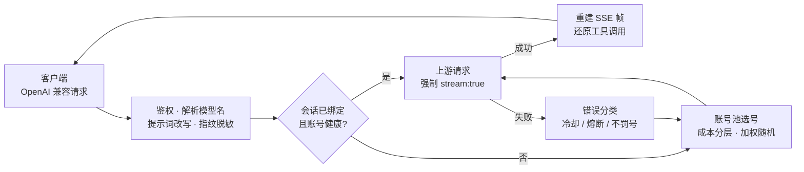

# 网关与选号

本篇说明一个请求进来以后，网关怎么挑账号、怎么改写请求、出错怎么处理。配置项的默认值见[配置](configuration.md)。

- [请求的一生](#请求的一生)
- [选号策略](#选号策略)
- [跨域负载均衡](#跨域负载均衡)
- [会话粘性](#会话粘性)
- [错误分类与账号处置](#错误分类与账号处置)
- [系统提示词与内容审核](#系统提示词与内容审核)
- [推理模型兼容](#推理模型兼容)
- [原生工具调用标记还原](#原生工具调用标记还原)
- [流式输出](#流式输出)

## 请求的一生



1. **鉴权**：`api_key` 非空时校验 `Authorization: Bearer <api_key>`（常量时间比较）。
2. **解析模型名**：`cn:` / `global:` 前缀决定去哪一域选号；不带前缀时默认走国内版，打开跨域负载均衡后两域合池。
3. **改写请求**：按 `prompt.mode` 处理系统提示词，清洗指纹串，补齐推理参数，统一 `developer` 角色、`tool_choice` 与 `image_url` 的写法；历史里配不上对的工具调用、工具名为空的工具调用连同结果一起剔除，免得上游拒收整个请求。
4. **选号**：会话已绑定且账号健康就直接用，否则从池里挑。
5. **转发**：出站一律 `stream:true`；客户端要非流式时，网关在本地把整段流聚合成一个响应。
6. **出错换号**：按错误类型决定是否惩罚账号，然后换一个账号重试。

## 选号策略

1. **过滤**：去掉禁用、暂停选号、冷却中、熔断中、在途已满的账号。
2. **成本分层**：账号对同一个模型的实测扣费可能不同（有的账号有免费额度）。网关按实测把账号分成三层——实测免费、尚无观测、实测收费——只在当前最优的一层里挑。
3. **积分保底**（`pool.credit_floor`，默认关）：余额低于保底值的账号不再接**实测收费**的模型，避免把余额打穿到连免费模型都用不了；免费层和无观测层不受影响。签到回血越过保底值后自动恢复。全池都触底时返回 503，不会放行。
4. **快过期加权**（`pool.prefer_expiring`，默认开）：窗口内（默认 7 天）有积分快过期的账号，权重 ×3。这是软偏好：不按到期先后排序，也和金额无关，弱于会话粘性和成本分层。
5. **加权随机**：`权重 = 积分占比 × 10 + 闲置补偿`。积分占比是该账号积分除以候选里的最大积分；闲置补偿每闲置一小时加 `idle_weight_per_hour`，封顶 `idle_weight_max`，从未用过的账号直接给满。按权重取前 5 个候选再随机。
6. **防惊群**：刚被选中的账号短时间内跳过；全部账号都在冷却时，从软冷却或熔断的账号里挑最早到期的顶上。

**成本探索**（`pool.cost_explore_interval`，默认 30 分钟）：如果免费层一直有号可用，尚无观测的账号就永远学不到真实成本。所以每个窗口会把一个真实请求改道给尚无观测的账号——不额外发请求，成功就完成学习，失败按正常错误处理。

## 跨域负载均衡

默认关闭。关闭时，不带前缀的模型名一律走国内版。打开 `pool.cross_realm` 后，不带前缀的模型名按两个域的模型目录分流：

| 情况 | 去向 |
|---|---|
| 两个域都有这个模型 | 国内版和国际版账号合成一个池，按上面的选号策略挑 |
| 只有一个域有 | 只在那个域选 |
| 两边目录都没有（目录没拉到，或模型名写错） | 走国内版，和关闭时一样 |

补充说明：

- 带前缀的模型名不受影响，想钉死某一域照旧加前缀。
- 模型目录在启动预热和 `/v1/models` 刷新时拉取；某次拉取失败沿用上次成功的目录。
- 积分保底和用量统计里的积分倍率都按实际服务的账号所在域计算（同一模型两域倍率可能不同）；请求日志的模型列写成 `域:模型名`。
- `/v1/models` 会在最前面额外列出不带前缀的名字（两域并集去重，`realms` 字段标出会分到哪些域）。
- 成本分层是硬过滤：某模型在一个域实测免费、另一个域收费时，请求会先全部落到免费那一域，那一域的号都占满或冷却了才轮到另一域。
- 需要同时启用国际版（`global.enabled`）。面板「配置 → 账号池与流量治理 → 选号权重」里可以开关，保存即生效。

## 会话粘性

同一会话尽量用同一个账号，多轮对话不跳号：

- **会话键**：依次取 `metadata.conversation_id`、`metadata.conversationId`、`metadata.user_id`、顶层 `conversation_id`、顶层 `conversationId`。
- **没有会话键时**：用「系统提示词 + 第一条用户消息」的哈希作为会话键，普通 OpenAI 客户端也能享受粘性。
- **上游前缀缓存**：会话键同时用来生成出站的 `prompt_cache_key`（客户端自己带了就不覆盖），同一账号下的不同会话各占一个缓存槽，不互相挤掉。
- 绑定有效期默认 30 分钟，每次使用滚动续期；配置了 Redis 时绑定会镜像过去（7 天 TTL），重启不丢。
- 请求失败自动解绑；绑定的账号因某个模型限额而不可用时，换模型的请求会重新分配；绑定账号触到积分保底时也会解绑换号。

## 错误分类与账号处置

| 分类 | 触发条件 | 账号处置 | 恢复 |
|---|---|---|---|
| 余额不足 | HTTP 402 / 余额关键词 | 冷却到**次日 04:00** | 签到或余额刷新发现余额恢复即解冻 |
| 频控 | HTTP 429 / 限流文案 | 软冷却 `soft_rate`，连续触发指数退避，封顶 `soft_rate_max` | 到期自动恢复，成功后清零退避 |
| 模型级限额 | 429 + `code 6004` | 冷却到上游给出的重置时间（封顶 `soft_rate_max`）；**换别的模型照样可用** | 到点自动恢复 |
| Session 失效 | `12153` / `Offline user session not found` | **连续 3 次**才禁用（单次多为网络抖动） | 重新登录，或面板「解冻」 |
| 上游 404 | HTTP 404 | 固定冷却 60 秒 | 到期自动恢复 |
| 服务端错误 | HTTP ≥ 500 | 计入连续失败，达阈值熔断 | 熔断到期或成功后清零 |
| 请求体解析失败 | 400 + `code 11101` | **不罚账号**，但仍换号 | 即时 |
| 内容拦截 | 400 + 审核文案 | **不罚账号**，按下一节降级重试 | 即时 |
| 其他客户端错误 | 其余 4xx / 业务码非 0 | 不处罚，换号重试 | 即时 |

**熔断**：所有冷却入口与 5xx 共用一个连续失败计数，累计达 `breaker_threshold`（默认 3）触发熔断，时长 `breaker_cooldown × 2^次数`，封顶 `breaker_cooldown_max`。成功即清零。

**软冷却退避**：同一账号连续触发软冷却时，冷却时长为 `soft_rate × 2^(连续次数-1)`，封顶 `soft_rate_max`。这个计数独立于熔断，只在成功或签到解冻时清零，随状态文件持久化。

**连败出池**：未知错误（传输层错误等）连败 `degrade_threshold` 次，临时出池 `degrade_cooldown`。

## 系统提示词与内容审核

Claude Code、Codex 等客户端会在系统提示词里放固定模板句，上游内容审核按逐字匹配可能误拦（HTTP 400 + 审核文案）。网关有两层防护：

1. **提示词模式**（`prompt.mode`）处理系统提示词：

   | 模式 | 行为 |
   |---|---|
   | `passthrough`（默认） | 透传客户端原始系统提示词 |
   | `custom` | 删除客户端全部 system / developer 消息，换成网关自带的一条；用户、助手、工具消息逐字不动 |
   | `append` | 在开头连续的 system / developer 消息之后插入一条网关提示词，客户端原有消息逐字不动 |

   内置提示词约 2KB（[`internal/prompt/defaultprompt.md`](../internal/prompt/defaultprompt.md)）；`prompt.file` 可替换成你自己的。

2. **指纹脱敏**（`features.sanitize_blacklist_fingerprints`）清洗用户、助手消息里的指纹串。

**降级重试**：请求被内容审核拦下时，网关判定为系统提示词误报，**在同一请求内**换成中性提示词重试一次；第二次仍被拦，说明是用户内容本身触发审核，如实返回给客户端。触发降级后到次日 00:00（北京时间）前，后续请求直接用中性提示词，不再先撞一次 400。降级状态只在内存里，重启清零。内容拦截不罚账号。

## 推理模型兼容

- **DeepSeek 思维链**：自动注入 `thinking.type=enabled` 与默认思考档位。
- **`reasoning_effort` 降级**：客户端要的档位该模型不支持时，自动降到最接近的可用档位。
- **`reasoning_content` 回填**：多轮对话里把上一轮的推理内容按上游要求回填到助手消息。
- `/v1/models` 透出每个模型支持的思考档位、默认档位、能否关闭思考，方便客户端按需选择。

## 原生工具调用标记还原

上游（DeepSeek 系）的工具调用原生语法是一段带**全角竖线**分隔符的标记文本（下面用 `<PIPE>` 代替两个全角竖线）：

```text
<PIPE>DSML<PIPE> calls>
<PIPE>DSML<PIPE> invoke name="exec_command">
<PIPE>DSML<PIPE> parameter name="cmd" string="true">ls -la<PIPE>DSML<PIPE> parameter>
</PIPE>DSML<PIPE> invoke>
</PIPE>DSML<PIPE> calls>
```

上游只在请求声明了 `tools` 时才把它解析成结构化的 `tool_calls`。而 `tools` 在中转链路上丢失是常态（协议转换丢字段、一次性探测、复核回合等），这时模型仍想调用工具，标记就以纯文本落进 `content`。Codex 这类只执行结构化调用的客户端会把它当普通正文，回合直接结束，工具一次都没跑。

网关在出站响应里把它还原成 `tool_calls`（流式与非流式都覆盖）：

| 工具名单 | 判定 |
|---|---|
| 非空 | 严格：块内每个工具名都必须在名单里 |
| 为空（`tools` 丢失） | 宽松：块必须完整闭合，且工具名是合法标识符 |

名单来自本次请求声明的工具和会话历史里出现过的工具名。另有三条前提：本回合上游没有给出任何结构化调用、块内不夹带正文、非流式要求 `finish_reason` 为 `stop`。**任何一条不满足都原样透出**，未闭合、参数畸形、超长（>256KB）一律不动。

命中与否各记一行日志，便于排查：

```text
INFO: [server] stream ...: repaired N native tool call(s) from assistant text (tool names known=K)
WARN: [server] stream ...: saw M native tool call block(s) but repaired none (tool names known=K)
```

## 流式输出

- SSE 帧按 OpenAI 规范**白名单重建**：保留 `reasoning_content`，工具调用按 index 合并，剥离未知字段。
- 保证恰好一个 `data: [DONE]`：上游漏发时补写；空流先写一帧 `error` 再补 `[DONE]`。
- 非流式请求由本地聚合为一个 `chat.completion` 响应，包含 `reasoning_content` 与 `tool_calls`。
- 还原工具调用时，一帧会拆成「正文帧 + N 个调用帧 + 收尾帧」，`finish_reason` 从 `stop` 改写为 `tool_calls`。
- 每个响应都带 `X-Request-Id`，可在面板请求记录里按它查找。
