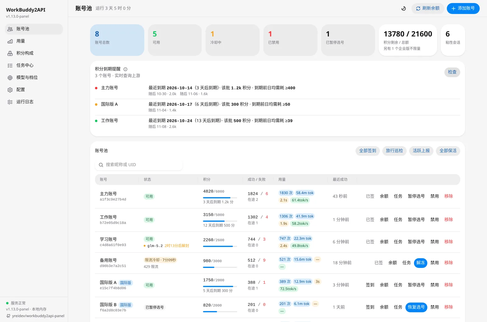
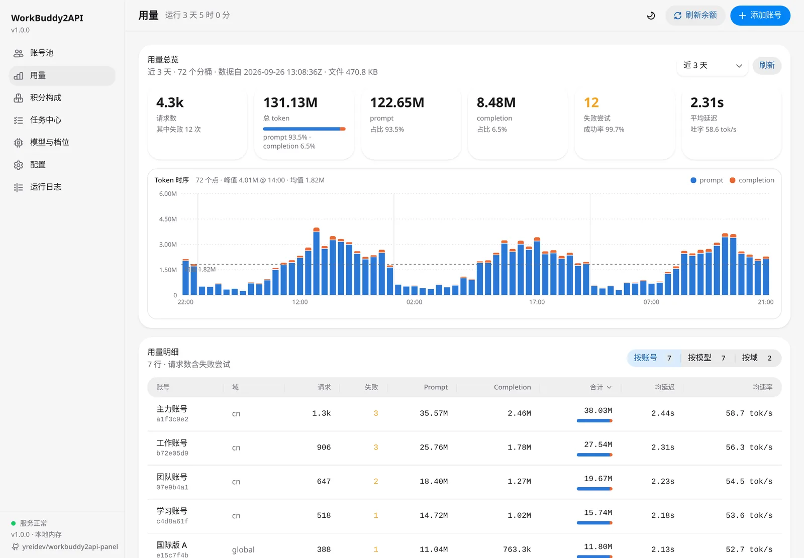
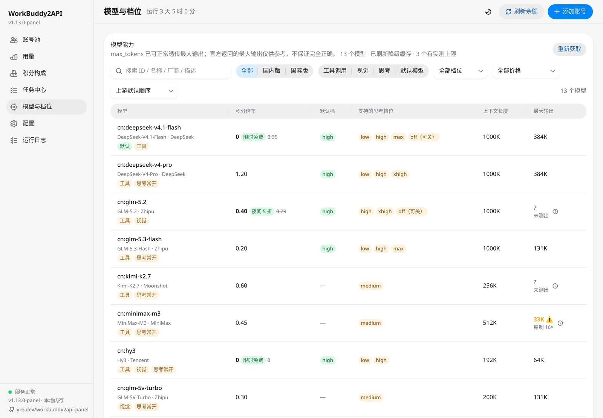
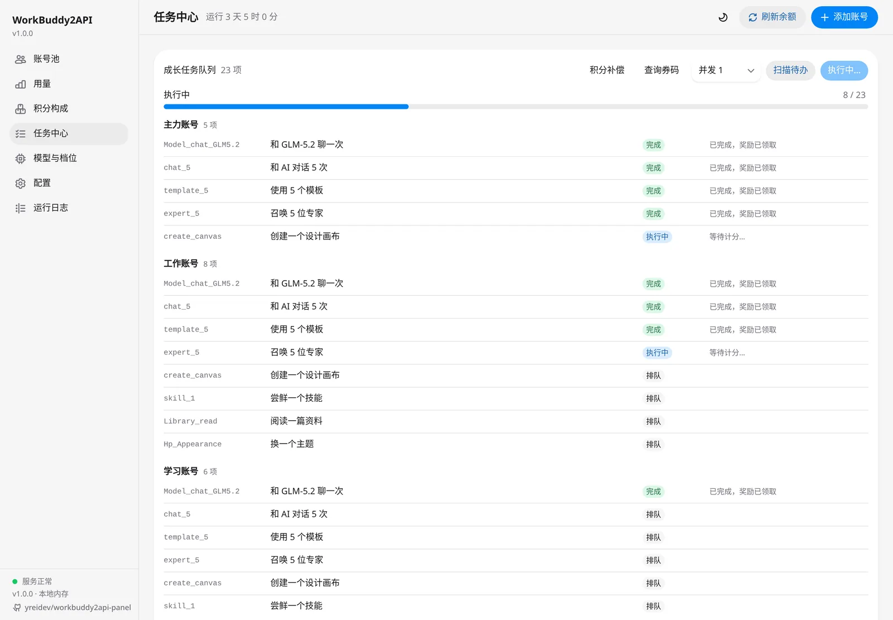
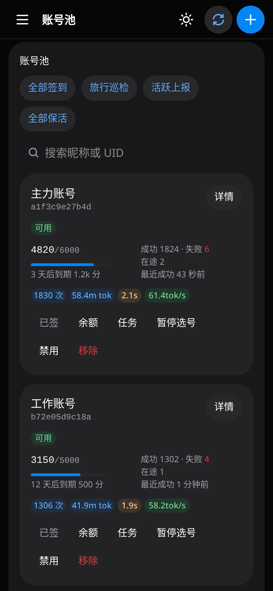
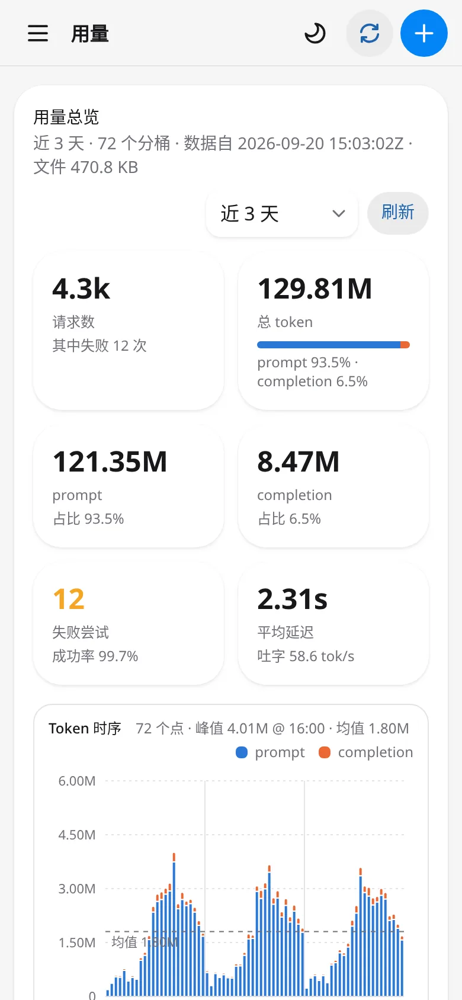
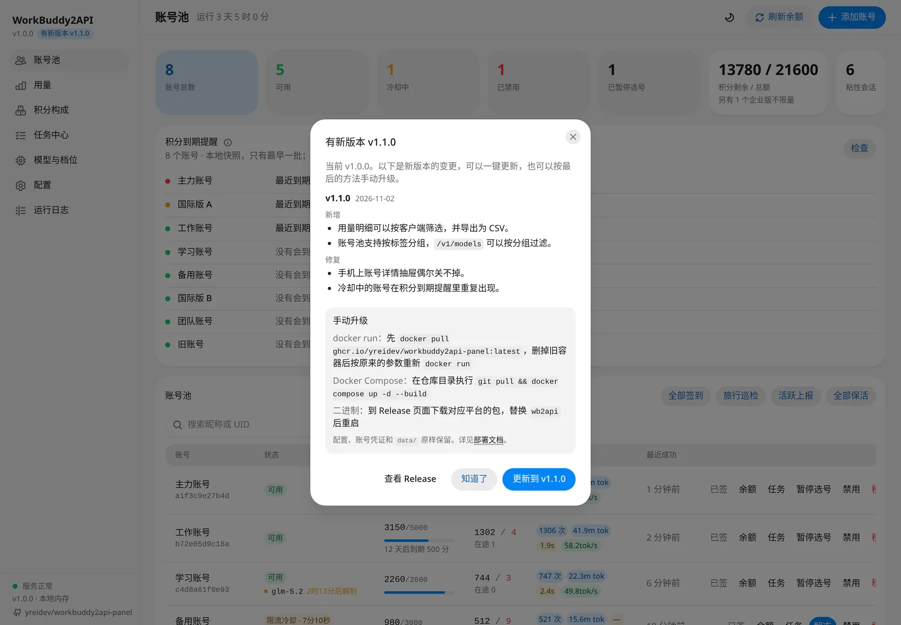

# Web 管理面板

面板打包在网关二进制里，启动后访问 `http://<主机>:7863/panel/`。

- `api_key` 非空时，首次打开需要输入一次密钥（浏览器会记住）；为空则直接进入。面板只认 `api_key`，客户端密钥登不了面板。
- 支持明暗主题（首次跟随系统）和手机端（导航收进抽屉，表格换成卡片）。

- [视图一览](#视图一览)
- [测活](#测活)
- [时间范围](#时间范围)
- [调用来源](#调用来源)
- [更新提醒](#更新提醒)
- [一键更新](#一键更新)
- [面板接口](#面板接口)
- [安全](#安全)

## 视图一览

| 视图 | 能做什么 |
|---|---|
| **账号池** | 统计卡：总数 / 可用 / 冷却 / 禁用 / 暂停，用了[代理池](proxy.md)时多一栏「因代理暂停」，点一下即按状态筛选；另有积分合计与粘性会话数。用了代理池时，代理连不上、到期、快到期或有号在等代理会在上面提醒。 积分到期提醒：打开就列出每个账号最早一批要过期的积分，以及到期前日均至少要用掉多少（本地快照，不查上游）；点「检查」逐账号向上游查询，看到全部到期批次。同一天（北京时间）到期的算一批；订阅、体验这类按周期刷新的包按刷新时刻算。 账号卡片：状态与冷却倒计时（风控暂停、积分冷却等分开标出，冷却的卡片描橙边、禁用的描红边）、冷却原因和被限额的模型及解封时间、积分量条与最早到期、成功 / 失败 / 成功率 / 在途、用量与速率、号所在的分组和优先级（没分组、优先级是 0 时不显示）、号走的代理和出口 IP、上次[测活](#测活)的结果；右上角箭头看详情。建了账号分组后，搜索框旁可以按分组筛（全部、没分组的号、某个分组）。宽屏可以在「卡片 / 表格」之间切换，选了哪种记在本浏览器；卡片视图用旁边的下拉排序，表格点表头排序。 单号操作：签到、余额、任务、测活、解冻、暂停选号、禁用、移除。 全部账号的任务：全部签到、旅行巡检、活跃上报、全部保活、全部测活。 多选：勾选账号（搜索框旁的「全选」或表格的表头勾选框 = 当前筛选结果全选）后，可以「导出凭证」（下载一个 JSON 文件；单个账号在详情里导出），或者从「批量操作」里选测活、暂停选号、恢复选号、加进分组、退出分组、设优先级、加不接的模型、删不接的模型、解冻、禁用、移除（加进、退出分组先选分组，设优先级先填数，加、删不接的模型先填模型名；还没建分组时没有加进、退出分组），逐号执行，做完提示几个成功、几个失败，失败的列出原因；禁用和移除先确认，测活在后台跑、结果显示在各号卡片上。例如清掉被限制的号：点「已禁用」筛出来，全选，「批量操作 → 移除」。用了代理池时旁边还有「绑定代理」：把勾选的号绑到池（池内按绑号最少分）、单独指定一个代理，或者解绑。 账号分组：每组一张卡片，写着备注、组里几个号、哪些客户端密钥限定了它；可以新建、改名和备注（名字最多 20 个字、不能重名，备注最多 100 个字；号和密钥按分组的 id 认，改名不影响它们）、删（还有密钥限定着它时不让删，先在密钥里去掉；删了组里的号退出这个组，号本身不动），点「筛选」只看组里的号。分组用来给[客户端密钥](api.md#客户端密钥)划号，本身不影响选号，见[选号策略](gateway.md#选号策略)。 模型锁池：哪些模型被上游按模型限额、还剩几个号可用、多久后解锁。 |
| **账号详情**（点账号行） | 备注：给账号写一句备注（最多 40 个字，只在面板上显示，存在网关的号池状态里，换浏览器、重新导入这个号都还在）；写了以后各页的账号名都先显示备注，没有备注才用昵称、再没有用 UID 前 8 位。请求记录里存的是记录时的「昵称(UID 前 8 位)」，显示和搜索时换成现在的备注（按原来的昵称也搜得到）。 分组与优先级：勾选这个号在哪些分组里（勾上、取消都马上保存），改优先级（0～99，越小越先用，默认 0，改完点保存）。选号只在优先级最小、此刻能接的那一层号里挑，那层都接不了才轮到下一层，见[选号策略](gateway.md#选号策略)。 不接的模型：选号时不把这些模型派给这个号。上游回 `11158`（这类账号不能用这个模型）时自动加上，标「上游拒绝」，一直屏蔽到点 × 解除；也可以手动加，按不带 `cn:` / `global:` 前缀的模型名匹配，支持 `*` 通配（比如不想让这个号接贵的模型）。加、删都马上保存。 模型限额台账、每个模型的实测单价、最早到期批次、连败与熔断计数、最近一次请求的模型与耗时、上次测活；可单独导出这个号的凭证。用了代理池时有「代理」一节：分到的代理、池、出口 IP，号被代理拦着时写明原因，可以改绑 |
| **添加账号** | 浏览器内完成国内版 / 国际版 OAuth 登录，凭证落盘并热加载进池，不用重启；国际版会自动完成注册地区、激活与试用额度领取。也可导入 JSON：账号池导出的凭证（单个或批量），或 cockpit tools 导出的账号。用了代理池时两种方式都能选池，登录请求本身就走池里分到的代理，见[按号代理与代理池](proxy.md#添加账号导入导出凭证) |
| **代理** | 按号代理的管理，规则见[按号代理与代理池](proxy.md)。统计：代理数、能用、连不上、已到期、快到期、等代理的号，下面是要处理的提醒。 代理池：每个池一张卡片，写着是不是默认池、代理数与能用的、每个代理最多几个号、绑了几个号、几个在等代理；可以改、池内重新均分（会改号的出口 IP，要确认）、删。 代理表：搜索名字、地址、出口 IP，按池和状态（能用、不通、已到期、快到期、还没测）筛，多选删除；每个代理的状态与延迟、不通的原因、出口 IP 与地区（出口重复、和服务器同 IP、IP 变过另有标记）、到期时间、绑了几个号和哪些号；单个测试、修改、删除。 导入代理（粘贴或上传 txt，先预览再导）、导出（带密码）、全部重测、删掉不可用。 代理池设置：只许走号的代理、健康检查和查出口 IP 的间隔、连续不可用多久后改绑、到期前几天提醒、查出口 IP 的地址 |
| **用量** | 请求数、token 构成、失败率、平均延迟与吐字速率；按小时的 token 时序图；按账号 / 模型 / 域 / 密钥的用量明细；积分扣除历史（每百万 token 积分、前缀缓存命中率）。建过客户端密钥后可以按密钥筛，整页只算这个密钥的请求 |
| **请求记录** | 每次调用 API 的记录：成功率、平均耗时、进行中；每条请求的结果与失败原因、模型 / 账号 / 号走的代理 / 密钥 / 来源 IP / User-Agent / token 与缓存命中 / 积分 / 请求 ID，可按条件和时间范围从归档里查。失败原因是回给客户端的错误消息，最多 200 字，悬停看全文 |
| **积分构成** | 积分到期分布（按剩余天数、按账号着色）、账号对比、单账号逐包明细（按周期刷新的包，到期列标「刷新」） |
| **积分获取** | 签到、成长任务领奖、积分补偿、猫猫旅行、新手礼包、连登兑换领到的积分逐笔记录：合计、按来源、按账号，以及流水（时间、账号、来源、任务名或连登档位、积分）。按时间范围、账号、来源筛，合计算区间内符合条件的全部笔数，流水只列最新的 100 / 500 / 2000 笔。只记领到的，不记扣除（扣除看「用量」里的积分扣除历史）；升级到有这一页的版本之前领的没有记录。任务名要本次打开面板后在任务中心扫描过才认得，否则显示任务码 |
| **任务中心** | 扫描全部账号的成长任务待办，排队一键执行，实时显示进度；积分补偿查询与领取；券码查询 |
| **模型与档位** | 上方是[模型路由](api.md#模型路由)规则表：每条「匹配 → 目标模型」，可排序、一键把 Claude Code 三档加到最前面；被前面更宽的规则挡住、永远轮不到的规则会标红，「试一下」输入一个模型名看会被怎么处理（按编辑中的规则算，不用先保存）；保存即生效。 接着是[对外隐藏的模型](api.md#隐藏模型)：从目录选（带域前缀）或手填不带前缀的名字，加一项、删一项都立即生效；表格里被隐藏的模型标「对外隐藏」。 下方列每个模型的状态、积分倍率（含限时优惠）、默认思考档、支持的档位、上下文长度与最大输出。状态两个域都判，只用网关手上的证据、不另发请求：有[模型锁](gateway.md#错误分类与账号处置)时按锁标「限流中」「部分可用」「无权限」「上游无此模型」「暂无可用号」；没有锁就看网关内存里最近 100 条请求中最新一条用过这个模型、真发到上游的（密钥白名单、隐藏名单拦下的不算），标「可用」「限流」「上游错误」「最近失败」；都没有标「待验证」，目录里列着不代表号能用。悬停看依据和时间；只有企业号能用的模型标「企业专属」；可叠加[实测输出上限](deployment.md#探测模型真实输出上限)。支持关键词、域、能力、档位、价格筛选和多种排序，数据一次拉全后在浏览器里筛 |
| **密钥** | 新建、编辑、停用、重新生成、删除[客户端密钥](api.md#客户端密钥)：到期时间、每天和总量的请求次数 / token / 积分上限、模型白名单、只用哪些账号分组的号（建了分组才有这一项，不勾 = 不限）；列出每个密钥今天和累计的用量、最近使用时间；「接入方法」给出密钥原文和各客户端的填法（含 Codex 联网搜索的 MCP 配置）。管理员密钥（`api_key`）没设时页面顶部会提醒 |
| **配置** | 在线编辑配置，分服务 / 定时任务 / 账号池与流量治理 / 上游与高级 / 日志留存五组；底部保存条显示改了几项，需要重启的字段有标记，时长与时点当场校验。「日志留存」里请求记录、任务日志、系统日志、用量统计、积分获取各一张卡片，设开关、保留天数和容量上限，卡片下面显示现有的文件数、大小和最早日期，可以一键清空，见[日志留存](configuration.md#日志留存) |
| **运行日志** | 网关的系统与任务日志，按任务 / 系统频道、级别和关键字筛选。「实时」看最近 500 行，停在底部时每 5 秒跟随；「历史」按时间范围从磁盘上的留存里查，一次最多 5000 行，更早的日子也查得到。每次调用的流水行只打在终端，不进这里，面板里看「请求记录」 |

| 用量 | 模型与档位 |
|:---:|:---:|
|  |  |
| **任务中心** | **手机端** |
|  |   |

## 测活

测活就是给一个号发一条最短的真实对话（「hi」，回复最多 16 个 token），看它现在能不能用。走的是和真实请求同一条路径：刷新令牌、发给上游、错误分类和账号处置都一样，只是不选号，钉死这个号只发一次、不换号，也不绑会话粘性。做法参考了 new-api 的渠道测试和 sub2api 的账号测试。

- **单测**：账号卡片、表格或详情里点「测活」。弹窗里模型默认「自动（最便宜）」，按积分倍率挑这个号目录里最便宜的模型（国内版、国际版、企业号各按各的目录，[对外隐藏](api.md#隐藏模型)的模型、这个号不接的模型、上游回过 `11102` 还在避开的模型都不挑），也可以临时换一个。自动挑的模型被上游拒了（`11102` / `11158`，号本身没问题）就换下一个最便宜的再测，最多换 2 次。测完显示通不通、首字和总耗时、扣了多少积分、失败原因和上游回了什么。关掉弹窗网关也会测完，结果照样记下。
- **全部测活**：账号池右上角的「全部测活」，在后台同时测 2 个号，测所有没被人工禁用的号（网关自动禁用的、暂停选号的也测），结果显示在各号卡片上。上一批还没测完时再点会提示稍后再试。
- **定时测活**：默认每 30 分钟测一遍**整个号**在限流冷却、熔断或连败降权中的号，一个一个测。余额不足（有余额刷新管）、风控波整域暂停、只是某个模型被限额的号不测；因风控（`11140`）、登录失效（`12153`）被网关禁用的号也不定时测，要在面板上手动测。开关和间隔见[配置 · 定时任务](configuration.md#定时任务)的 `schedule.liveness_enabled`、`schedule.liveness_minutes`。

测通了：清掉这个号的账号级冷却（限流、余额不足）和测的这个模型的限额冷却，熔断和连败计数清零，网关自动加的禁用解除；人工禁用、暂停选号不动，[风控波整域暂停](gateway.md#错误分类与账号处置)也不因为一个号测通就解除。测不通：照真实请求的[错误分类](gateway.md#错误分类与账号处置)处置这个号，比如限流就进冷却；但人工禁用的号不会被改成网关自动禁用（之后测通也不解除），已经禁用的号复测时再回 `11140` 也不算新的风控、不会触发风控波整域暂停。这个号在途已满时不排队，直接记一次不通（503），过一会儿再测。

每次测活都记进请求记录（路径 `/panel/liveness`，密钥一列写「测活」）和这个号的用量（用量页按密钥分时叫「测活」），不算任何客户端密钥的用量；账号卡片上的成功、失败次数也包含测活。上次测活的结果存在号池状态里，重启不丢；运行日志的任务频道里每次测活记一行。测活真的会发一次对话，可能扣一点积分。

## 时间范围

「用量」「请求记录」和运行日志的「历史」共用同一个时间范围控件：今天 / 近 24 小时 / 近 3 天 / 近 7 天 / 近 30 天 / 全部历史 / 自定义（精确到分钟）。

- 「今天」和「自定义」由浏览器按本地时区算好区间再发给服务端，服务端和浏览器时区不同时也不会切错日子。
- 用量页的滚动预设按整点往回数 N 小时，与统计分桶对齐。
- 请求记录和运行日志的时间过滤在服务端的留存里完成，查更早的时段也能取到；能查多早看[日志留存](configuration.md#日志留存)设的保留天数。

## 调用来源

请求记录会显示每次调用的来源 IP 和 User-Agent，用来排查「谁在用网关」：

- IP 依次取 `X-Forwarded-For` 首段、`X-Real-IP`、TCP 对端地址；
- User-Agent 截断到 200 字节；终端里的请求流水行会附上压缩后的客户端标签。

IP 属于个人信息，所以由 `logging.request_client_info` 控制，默认开启、热生效，可在「配置 → 日志留存 → 请求记录」里关掉。关闭后归档与面板都不再出现来源字段。

## 更新提醒

- **有新版本**：网关每 6 小时从 GitHub 读取一次本仓库的[更新日志](CHANGELOG.md)，发现比自己新的版本时，面板弹窗列出新版本的变更、升级方法和 Release 链接，能[一键更新](#一键更新)时还有「更新到 vX」按钮。每个新版本只自动弹一次；没升级前，侧栏版本号旁一直显示「有新版本」，点开可以再看；出了更新的版本会再弹。跑正式版时不提醒预发布版本。
- **本次更新**：升级后第一次打开面板，弹窗列出这次升级包含的变更，内容取自二进制内嵌的更新日志，不联网。某个浏览器里没有看过的记录时（新装，或从还没有更新提醒的 1.13.0-panel 及更早版本升上来），也会弹一次，只列当前这一版。
- 弹过哪些提醒记在浏览器的 localStorage 里，换浏览器或清除站点数据后会再弹一次。
- 检查只是一个 GET 请求，不带任何本机信息。读不到（例如服务器访问不了 GitHub）就在运行日志里记一行，6 小时后再试，不影响其他功能。
- 在「配置 → 服务」关掉「检查更新」（`panel.update_check`）即停止联网检查，立即生效；「本次更新」不受影响。

 演示数据，v1.1.0 的条目是虚构的。

版本号规则与发版流程见[发版与版本号](releasing.md)。

## 一键更新

「有新版本」弹窗里点「更新到 vX」并确认后：

1. 网关从本仓库的 GitHub Release 下载 `checksums.txt` 和当前平台的安装包，核对 sha256；
2. 解出 `wb2api` 试运行一次（`wb2api -version`），确认能在这台机器上执行、版本也对；
3. 放进数据目录（`state_file` 所在的目录，Docker 里是 `/app/data`）的 `bin/wb2api`，旁边的 `bin/current.json` 记下版本和校验值；
4. 优雅停机：和收到停止信号一样，在途请求最多等 `WB2A_SHUTDOWN_TIMEOUT`（默认 5 秒）。然后原地重启到新版，进程号不变，不依赖 Docker 的重启策略或 systemd。

面板显示进度，新版上线后自动刷新并弹出「本次更新」。前两步失败不会影响正在运行的网关，弹窗里会给出原因。

程序自带的那份（镜像里的 `/app/wb2api`，或你自己放的二进制）始终不变：

- 每次启动先由自带程序检查 `bin/` 里有没有比自己新的版本，有就切过去。新版放在数据卷里，所以 `docker compose up -d` 重建容器也不会退回旧版。
- 以后拉了更新的镜像，自带版本不比 `bin/` 里的旧时，以自带版本为准，并删掉 `bin/` 里那份。
- 新版启动后要稳定运行 30 秒才算成功；没满 30 秒但被正常停掉（`docker restart`、`docker compose up -d` 重建）也算。连续 3 次都没做到（启动就崩、端口被占、被 `kill -9`……）时，自带程序不再切过去，「版本信息」里会提示，可以删掉那份。这一条要靠重启策略把崩溃的进程拉起来，裸跑二进制时就是下次手动启动时生效。
- 点侧栏的版本号打开「版本信息」：可以看到当前运行的是面板安装的版本还是程序自带的版本，能立即检查更新，也能「退回 vX」到程序自带的版本（删掉 `bin/` 里那份后重启）。

限制：

- 只支持 Linux 与 macOS（amd64 / arm64）。Windows 不能原地重启，弹窗里只给手动升级方法。
- 只更新网关本身。镜像里的 `login`、`signin_bin`、`credit` 等命令行工具和脚本仍是镜像自带的版本，要更新它们得拉新镜像。
- 数据目录必须可写，而且不能挂载成 `noexec`（试运行时会报出来）。
- 下载走 `github.com`，认 `HTTPS_PROXY` 环境变量。服务器访问不了 GitHub 时一键更新会失败，按弹窗里的方法手动升级即可。
- 没有单独的开关，跟着「检查更新」（`panel.update_check`）走：关掉检查就不会出现「更新到 vX」按钮，但「版本信息」里仍然可以退回。
- 多实例或 Kubernetes 部署时，一键更新只更新当前这一个实例，建议改镜像标签统一升级。

## 面板接口

面板的所有操作都是 `/panel/api/*` 接口，与页面使用同一个 Bearer 鉴权，可以直接写脚本调用：

| 分组 | 端点 |
|---|---|
| 只读 | `GET overview` · `version`（`since` = 上次看过的版本，返回之后到当前版本的更新日志，`none` 表示没看过、只返回当前这一版；更新检查开着时另有远端最新版本和比本机新的各版本条目；`self_update` 是一键更新的状态与进度）· `usage`（`hours` 或 `from`/`to`；`key` = 只看一个密钥：客户端密钥的 id、`admin` 是管理员密钥、`liveness` 是测活、`-` 是没开鉴权或 1.3.0 之前的数据）· `packages` · `models` · `model_probes` · `logs` · `logs/archive`（按时间范围查运行日志的留存：`from` / `to` / `ch`（`task` / `sys`）/ `level`（`warn` = 警告及错误，`error` = 仅错误）/ `q` / `limit`（默认 500，最多 5000）；返回区间内最新的 `limit` 行，按时间先后排，`more` = 更早的还有没返回的）· `log_storage`（请求记录、任务日志、系统日志、积分获取的文件数、大小、最早日期和保留天数，用量统计的明细条数与 `usage.json` 大小）· `credit_log`（积分获取流水：`from` / `to` / `uid` / `source`（`checkin` / `task` / `compensation` / `travel` / `gift` / `redeem`）/ `limit`（默认 500，最多 5000）；返回区间内最新的 `limit` 笔，新的在前，`more` = 更早的还有没返回的；`total`、`count`、`by_source`、`by_account` 算的是区间内符合条件的全部）· `request_metrics` · `request_logs`（`limit` / `outcome` / `account` / `model` / `client_ip` / `user_agent` / `api_key`（密钥名）/ `from` / `to`）· `config` · `tasks/queue` · `school/vouchers` |
| 账号运维 | `POST accounts/{uid}/checkin` · `balance` · `revive` · `pause` · `resume` · `disable` · `remove` `POST accounts/{uid}/note`（`{"note":"…"}`，去掉首尾空白后最多 40 个字、不能有换行，空串清除；总览的账号带 `note`） `POST accounts/{uid}/blocked_models`（`{"models":["gpt-*",…]}`，整份替换这个号不接的模型：去掉的解除，新加的算手动加的；模型名不带域前缀、不能有空格、一项最长 128 个字符、最多 100 项；返回 `{"ok":true,"blocked_models":[{"model","auto","reason","at"}]}`，总览的账号带同样的 `blocked_models`） `POST accounts/{uid}/groups`（`{"groups":["分组 id",…]}`，整份替换这个号所在的分组；有不存在的分组回 400）· `POST accounts/{uid}/priority`（`{"priority":0}`，0～99，越小越先用；总览的账号带 `groups`（没分组时没有）和 `priority`） `POST accounts/{uid}/liveness`（测活，等测完再返回 `{"result":…,"reply":"上游回复"}`；可带 `{"model":"…"}`，不带 = 自动挑最便宜的；挑不出模型回 422；总览的账号带 `last_liveness`） `POST checkin_all` · `travel_all` · `activity_all` · `keepalive_all` · `balance_all` · `liveness_all`（全部测活，后台跑，返回要测的号数 `total`；已有一批在跑回 409） `POST accounts/export`（`{"uids":[…]}`，返回 `{"accounts":[…]}`，每项与 `auths/workbuddy-<uid>.json` 同形，绑了代理的号另带 `proxy_url`；有 uid 不在池里时整单 404） `POST accounts/batch`（`{"action":"revive|disable|pause|resume|remove|liveness|block_models|unblock_models|join_group|leave_group|priority","uids":[…]}`，`block_models` / `unblock_models` 另带 `"models":[…]`，把这些模型加进、删出每个号不接的模型名单（删的时候上游拒绝后自动加的也删，按名字一字不差地删）；`join_group` / `leave_group` 另带 `"group":"分组 id"`，把号加进、退出这个分组（已经在里面、本来不在的不动，分组不存在回 400）；`priority` 另带 `"priority":0`（0～99）；逐号执行，一个号失败不影响其余的号，返回 `{"ok":成功个数,"failed":[{"uid","error"}],"file_errors":[{"uid","error"}]}`，`file_errors` 是移除了但凭证文件没删掉的号；`liveness` 在后台测选中的号（人工禁用的也测，被代理池拦着的跳过），返回 `{"started":true,"total":要测的号数}`，已有一批在跑回 409） |
| 任务 | `GET accounts/{uid}/tasks` `POST accounts/{uid}/tasks/accept` · `accept_all` · `claim` · `auto` · `auto_all` `POST tasks/scan_all` · `tasks/run_queue` |
| 积分补偿 | `GET compensation`（逐账号查询官方状态，含已禁用账号，带 `disabled` 标记） `POST accounts/{uid}/compensation/claim` · `POST compensation/claim_all`（先查状态再领取，已禁用账号只查不领；批量结果逐账号返回） |
| 添加账号 | `POST login/start`（`{"realm":"cn"}`，用了代理池时可带 `pool`：空 = 这个域的默认池，`-` = 不绑，其余是池 ID；池里没有可用的空位回 400）· `GET login/poll`（登录完成时另带 `proxy`：号的代理情况，`proxy_kept`：号原来就在池里、沿用了原来的绑定）· `GET login/regions` · `POST import`（multipart 字段 `file`，用了代理池时可加 `proxy_pool`，取值同 `pool`；网关凭证与 cockpit tools 格式逐项自动识别，单个对象或数组都行；旧路径 `import/cockpit` 仍可用） |
| 代理 | 没装代理池时都回 501；字段与规则见[按号代理与代理池](proxy.md)。总览另带 `proxy_blocked`（被代理拦着的号数，不算进 `cooling`）和 `proxies`（代理池摘要），每个账号带 `proxy_blocked`（被拦的原因） `GET proxies`（`view`：池、代理、设置、警告、没绑代理的号的出口；`accounts`：每个号的代理情况。地址里的密码打了码） `POST proxies/preview`（`{"text":"…","scheme":"http"}`，返回每一行的解析结果，不改东西）· `POST proxies/import`（再加 `pool`、`expires_at`，返回加进来的 `added`）· `GET proxies/export`（纯文本，带密码） `POST proxies/{id}`（`name` / `url` / `pool` / `expires_at` / `clear_expiry`）· `POST proxies/{id}/test`（测完才返回）· `POST proxies/test_all`（后台测，返回个数 `total`）· `POST proxies/delete`（`{"ids":[…]}`）· `POST proxies/delete_unavailable` · `POST proxies/settings`（整份提交，返回生效的 `settings`） `POST proxies/bind`（`{"uids":[…]}` 再加 `pool`（池 ID）、`proxy`（代理 ID）或 `unbind: true` 其中一个，逐个返回结果） `POST proxy_pools`（`name` / `max_per_proxy` / `default_cn` / `default_global` / `adopt_unbound`，返回 `id`）· `POST proxy_pools/{id}`（修改，字段同上）· `POST proxy_pools/{id}/delete`（池里还有代理时回 400）· `POST proxy_pools/{id}/rebalance`（返回换了代理的号数 `moved`） |
| 账号分组 | `GET groups`（`groups`：每个分组的 `id` / `name` / `note` / `created_at`，组里几个号 `accounts`，限定了它的密钥名 `keys`） `POST groups`（`{"name":"…","note":"…"}`，名字去掉首尾空白后 1～20 个字、备注最多 100 个字，都不能有换行；重名（不区分大小写）回 409；返回 `group`）· `POST groups/{id}`（改名字和备注，字段同上）· `POST groups/{id}/delete`（还有密钥限定着它时回 409 并列出密钥名；删了组里的号退出这个组） |
| 客户端密钥 | `GET keys`（`keys` 带原文和今天、累计用量；`admin_key_set`：设没设 `api_key`；`required`：`/v1/*` 是否必须带密钥） `POST keys`（新建，字段 `name` / `note` / `enabled` / `expires_at`（RFC 3339 或 `null`）/ `daily_limit` / `total_limit`（`requests` / `tokens` / `credits`，不填 = 不限）/ `models` / `groups`（只用这些账号分组里的号，空 = 不限；有不存在的分组回 400））· `POST keys/{id}`（修改，整份提交）· `POST keys/{id}/regenerate` · `POST keys/{id}/delete` |
| 写入 | `POST config`（校验 → 落盘 → 热应用，返回需重启的字段）· `POST usage/save`（立即把内存里的用量落盘）· `POST log_storage/{kind}/clear`（清空一类日志留存，`kind` = `requests` / `task` / `system` / `usage` / `credit`；文件全删，含今天正在写的） |
| 更新 | `POST version/check`（立即检查更新，返回同 `version`；30 秒内重复调用直接返回上次结果） `POST update`（`{"version":"x.y.z"}`，必须是检查到的、比本机新的版本；在后台下载校验后重启，进度看 `version` 返回的 `self_update`） `POST update/rollback`（删掉面板安装的版本；正在运行它时重启回程序自带的版本） |

## 安全

- 面板页面与全部 `/panel/api/*` 响应都带 `Content-Security-Policy`（`default-src 'none'`，脚本仅同源，禁止被嵌套）、`X-Content-Type-Options: nosniff`、`X-Frame-Options: DENY`、`Referrer-Policy: no-referrer`；前端没有内联脚本。
- 密钥校验用 SHA-256 摘要加常量时间比较。
- 上游返回的 `uid` 经白名单校验（`[A-Za-z0-9_-]`，不超过 64 位）后才用于拼凭证文件名，防止路径穿越。
- 服务本身只提供 HTTP。公网部署请放在 HTTPS 反向代理之后，并设置 `api_key`。
